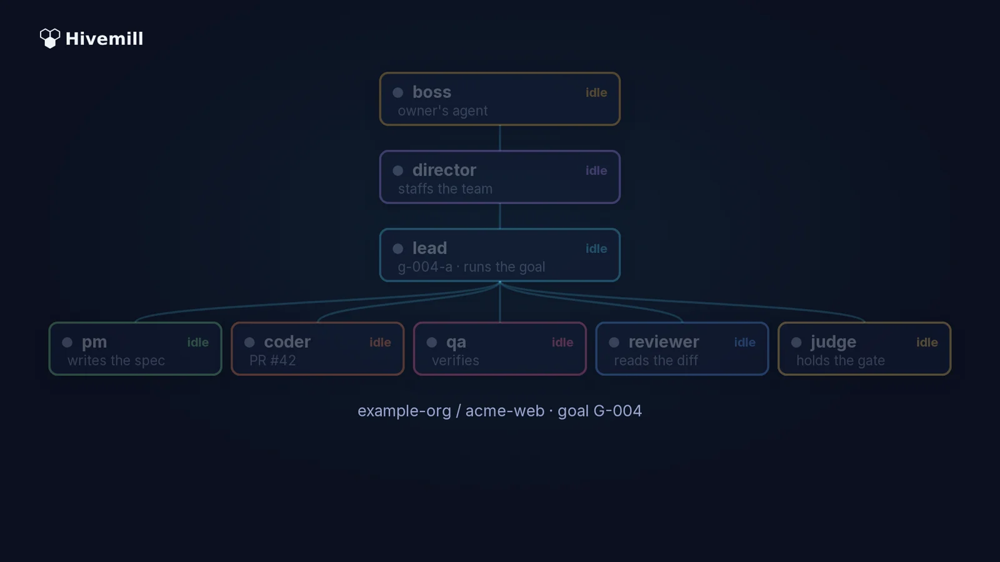
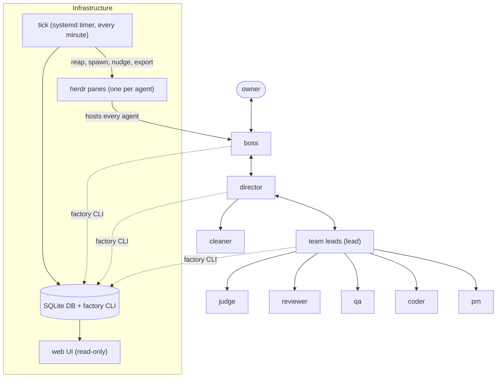
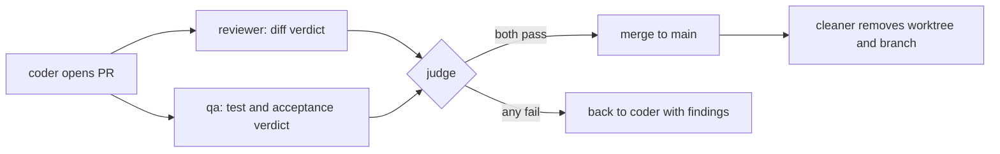
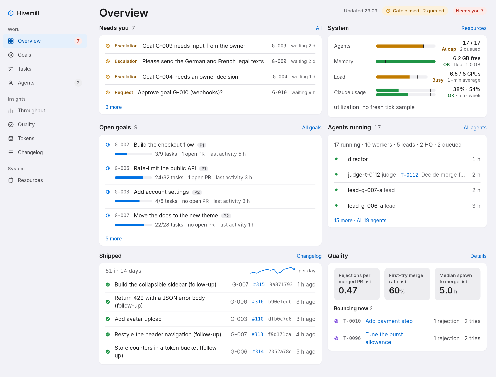
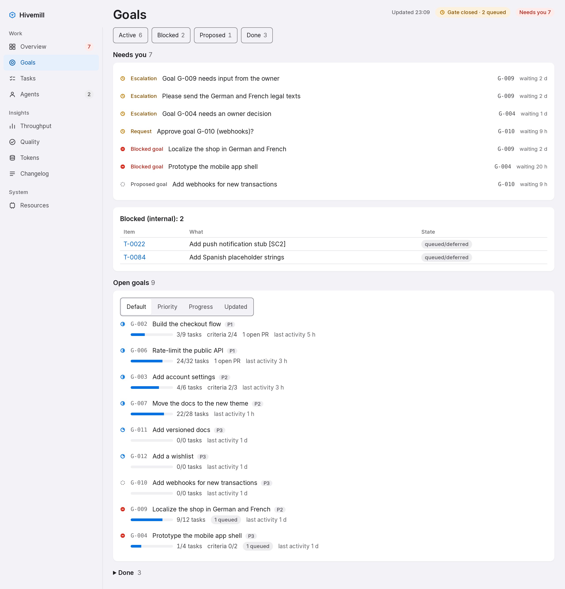
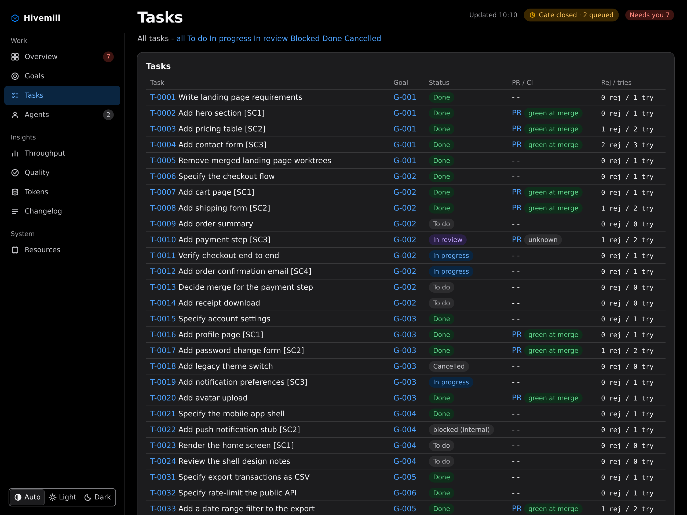
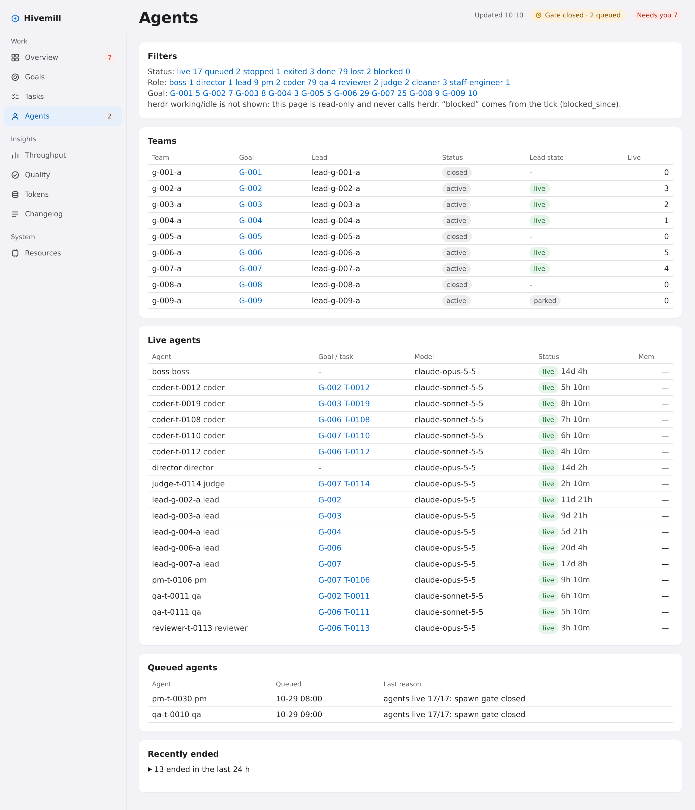
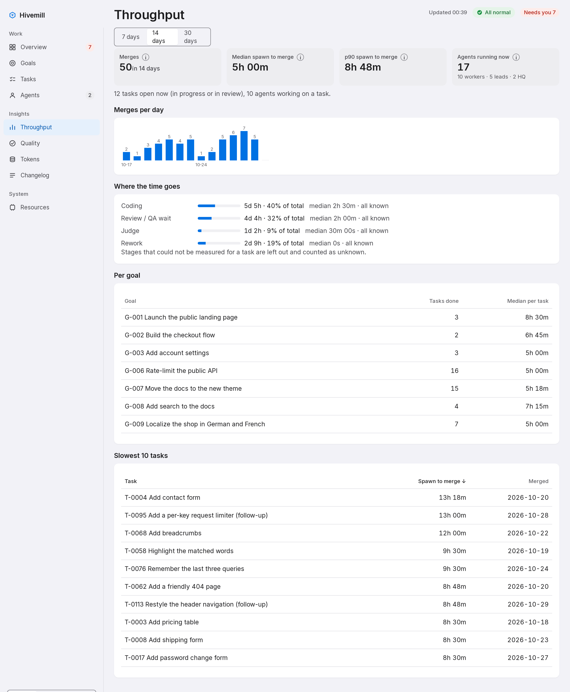
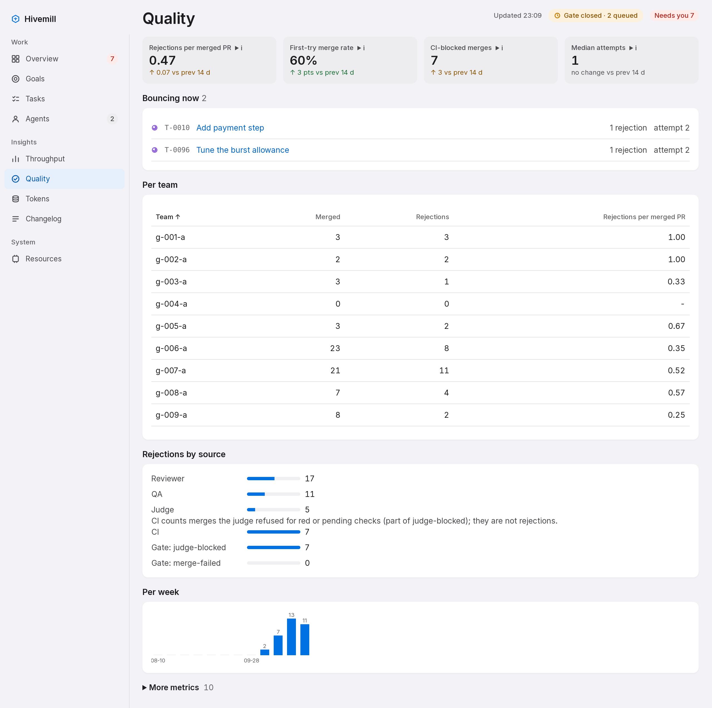

<a id="readme-top"></a>

<p align="center"><picture><source media="(prefers-color-scheme: dark)" srcset="docs/images/wordmark-dark.svg"></picture></p>

# Hivemill

<p align="center">
  <a href="https://github.com/volekerb/hivemill/actions/workflows/tests.yml"></a>
  <a href="LICENSE"></a>
  <a href="docs/SETUP.md"></a>
  <a href="https://github.com/volekerb/hivemill/releases"></a>
</p>

<div align="center">

**A self-hosted software factory of Claude Code agents with review, QA and a judge merge gate.**

Hivemill's CLI is `factory`.

</div>

<p align="center">
  <a href="#quickstart">Quickstart</a> ·
  <a href="docs/README.md">Docs</a> ·
  <a href="docs/examples/README.md">Examples</a> ·
  <a href="docs/adopt/ADOPT.md">Adopt with Claude</a> ·
  <a href="SECURITY.md">Security</a> ·
  <a href="https://github.com/volekerb/hivemill/discussions">Discussions</a>
</p>

---

https://github.com/user-attachments/assets/7615b7c0-48b0-4b44-ad01-aacd7f692583

<p align="center">
  <a href="https://github.com/volekerb/hivemill/releases/download/v0.1.0/demo.mp4"></a>
</p>

<p align="center"><a href="https://github.com/volekerb/hivemill/releases/download/v0.1.0/demo.mp4">Watch the full 76-second demo (MP4)</a> · <a href="docs/demo/README.md">how it was made</a></p>

You describe what you want built to one boss agent. It turns the request into a goal, a director staffs a team, and a chain of coders, QA, reviewers and a judge ships it as pull requests. The coder who writes a change never reviews, tests or merges it, and every goal, task, message and verdict is a row in one SQLite database behind the single `factory` CLI.

The factory runs on [herdr](https://herdr.dev), the terminal multiplexer that hosts the agent panes ([source](https://github.com/herdrdev/herdr), pinned release [v0.9.5](https://github.com/herdrdev/herdr/releases/tag/v0.9.5)).

## Quickstart

Needs Python 3.11+, git, `gh`, `herdr` and a logged-in Claude Code. Full steps and troubleshooting: [docs/SETUP.md](docs/SETUP.md). Every output below was captured from a real run against the seeded demo home ([docs/demo-data.md](docs/demo-data.md)); `...` marks every cut (whole lines or parts of lines).

### 1. Look around without herdr or Claude

Seeded fictional data, nothing real runs. Run from the repository root:

```
export TRIAL=$(mktemp -d)
python3 ci/demo_seed.py --home "$TRIAL/demo" --now 2026-10-25T12:00:00+01:00
```

```
seeded .../demo/db/factory.db at now=2026-10-25T11:00:00+00:00: 12 goals, 111 tasks, 258 verdicts, 187 messages, 105 agents, 755 events
scrub scan: no hits
view it with (the HOME prefix is MANDATORY: without it the tokens page shows the real owner's live usage):
  HOME=... FACTORY_HOME=... factory serve --bind 127.0.0.1 --port 8799
```

Serve the read-only web UI on it:

```
HOME=$TRIAL/demo/home FACTORY_HOME=$TRIAL/demo bin/factory serve --bind 127.0.0.1 --port 18624
```

```
factory serve: http://127.0.0.1:18624/ (read-only, LAN only, no auth)
127.0.0.1 "GET / HTTP/1.1" 200 -
127.0.0.1 "GET /goals HTTP/1.1" 200 -
```

Open <http://127.0.0.1:18624/>. In another shell, list the demo goals (put `HOME=$TRIAL/demo/home FACTORY_HOME=$TRIAL/demo` in front of every `factory` command below):

```
factory goal list
```

```
ID     STATUS    PRIORITY  PROJECT_ID  DONE  TOTAL  TITLE
G-002  active    1         acme-web    3     9      Build the checkout flow
G-006  active    1         ledger-api  23    31     Rate-limit the public API
G-003  active    2         acme-web    4     5      Add account settings
...
G-011  planning  3         docs-site   0     0      Add versioned docs
G-012  planning  3         acme-web    0     0      Add a wishlist
```

### 2. Run the real factory

Put the CLI on your `PATH` (`~/.local/bin` must exist and be on it), then initialise:

```
git clone https://github.com/volekerb/hivemill.git ~/factory
cd ~/factory
ln -s "$PWD/bin/factory" ~/.local/bin/factory
factory init
```

```
initialised .../db/factory.db
```

Then register a project, bring up the headquarters and open the web UI:

```
factory project add myapp --name "My app" --repo ~/src/myapp --gh example-org/myapp
factory up
factory serve --bind 127.0.0.1
```

`project add` and `up` need a plain shell (workers are refused), a running herdr server and a logged-in Claude Code, so their output is not reproduced here; the walk-through is in [docs/SETUP.md](docs/SETUP.md). Then open the boss's pane in herdr and describe what you want built.

<details>
<summary>Let Claude set it up</summary>

[docs/adopt/ADOPT.md](docs/adopt/ADOPT.md) is an instruction file for your own Claude Code. It installs the factory step by step, checks each command's output against an expected result, and stops to ask before anything that touches GitHub, git config or your machine outside the checkout. In a fresh checkout, paste this into Claude Code:

```
Read docs/adopt/ADOPT.md in this checkout and set up Hivemill step by step; stop before anything outside the checkout.
```

</details>

<details>
<summary>Try the full CLI against a stub herdr</summary>

[docs/SETUP.md#try-it-without-herdr](docs/SETUP.md#try-it-without-herdr) runs the real CLI and web UI against the stub `herdr` in `tests/stubs/`, including `factory up` and `factory agents`, under a throwaway home. This is also what the fresh-install test follows.

</details>

## A task's life in commands

Same demo home (`HOME=$TRIAL/demo/home FACTORY_HOME=$TRIAL/demo` in front of each command). Three walkthroughs with full output: [from a goal to a merged PR](docs/examples/01-goal-to-merged-pr.md), [handling a rejection](docs/examples/02-handling-a-rejection.md), [the digest and scorecard](docs/examples/03-digest-and-scorecard.md).

A goal, with its intent, success criteria, plan, team and tasks:

```
factory goal show G-002
```

```
# G-002 — Build the checkout flow
status=active priority=1 project=acme-web

## intent
Let a visitor pay for a cart in one short flow.

## success_criteria
1. Cart page works.
2. Shipping details are collected.
3. Payment step completes an order.
4. Confirmation email is sent.

## plan v1 (lead-g-002-a, 2026-10-13T15:48:00+00:00)
1. Specify
2. Build
3. Verify

## teams
ID       LEAD_AGENT    STATUS  SCOPE
g-002-a  lead-g-002-a  active  Cart, shipping, payment and confirmation

## tasks
ID      STATUS       ROLE   ASSIGNEE      DEPENDS_ON  PR_URL                                            TITLE
T-0006  done         pm     pm-t-0006     []                                                            Specify the checkout flow
T-0007  done         coder  coder-t-0007  ["T-0006"]  https://github.com/example-org/acme-web/pull/104  Add cart page [SC1]
...
T-0014  todo         coder                ["T-0010"]                                                    Add receipt download
```

One task with its acceptance criteria and every verdict. This one failed QA, was rejected by the judge for touching a file no acceptance item covers, and merged on the third attempt:

```
factory task show T-0004
```

```
id: T-0004
goal_id: G-001
...
title: Add contact form [SC3]
role: coder
status: done
...
attempts: 3
...
## acceptance
1. A valid post returns 200 and queues one email.
2. A missing email returns 422 with a field error.
3. A message over 2000 characters is rejected.

## verdicts
- ... qa FAIL @ba49e234 by qa-t-0004: Changes needed: POST /api/contact with email 'a@' returned 200, expected 422 (api/contact.py:31 only checks for an @ sign).
- ... reviewer PASS @3bb1e7aa by reviewer-t-0004: Checked input validation in api/contact.py and that the mail queue call is made once per request.
- ... qa PASS @3bb1e7aa by qa-t-0004: Posted a valid, an invalid-email and a 2001-character message; got 200, 422 and 422 as specified.
- ... judge REJECT @3bb1e7aa by judge-t-0004: Rejected: the diff edits src/cart.js:88, which no acceptance item of this task covers. Remove it or split it into its own task.
- ... reviewer PASS @a6bd606d by reviewer-t-0004: Checked input validation in api/contact.py and that the mail queue call is made once per request.
- ... qa PASS @a6bd606d by qa-t-0004: Posted a valid, an invalid-email and a 2001-character message; got 200, 422 and 422 as specified.
- ... judge MERGE @a6bd606d by judge-t-0004: Reviewer and QA PASS at a6bd606d; checks green; merging.
...
```

Reviewers and QA record verdicts with `factory verdict`, the judge merges or rejects with `factory judge` ([docs/verdict-gates.md](docs/verdict-gates.md)). The owner's overview of everything:

```
factory digest
```

```
# Factory digest ...

Leads: 5 live, 1 parked, 0 queued; workers live 10

## G-002 — Build the checkout flow (active)

### Done
_nothing_

### In progress
- T-0010 Add payment step [SC3] (in_review, coder-t-0010, attempts 2)
- T-0011 Verify checkout end to end (in_progress, qa-t-0011, attempts 1)
- T-0012 Add order confirmation email [SC4] (in_progress, coder-t-0012, attempts 1)
...
### Team scores
| team | tasks | done | merged | rejections | retries | score |
|---|---|---|---|---|---|---|
| g-002-a | 9 | 3 | 2 | 2 | 2 | 4.0 |
...
```

## How it works

- **Separation of roles.** Each role has its own prompt and its own permission settings, enforced by hooks rather than by trust.
- **Evidence over claims.** A task is done when a reviewer and QA have checked the PR diff and a real test run, not when an agent says so.
- **Resource-aware on a small box.** A spawn gate watches RAM, load and the number of Claude processes, and queues new agents until there is room. The whole factory runs on one modest VM.
- **Everything auditable.** Goals, plans, tasks, messages, verdicts and decisions are rows in SQLite with an append-only event log, exported to readable markdown every minute.



The merge gate, for every change:



Details: [docs/lifecycle.md](docs/lifecycle.md), [docs/verdict-gates.md](docs/verdict-gates.md), [docs/db-layout.md](docs/db-layout.md).

## Features

| Feature | What it does | Docs |
|---|---|---|
| **Run it** | | |
| Setup and operations | Install, boot units, reboot recovery, identity rules | [SETUP](docs/SETUP.md), [operations](docs/operations.md) |
| Adopt with Claude | An instruction file your own Claude Code follows to install it | [ADOPT](docs/adopt/ADOPT.md) |
| **Ship safely** | | |
| Verdict gates | The judge merges only on passing reviewer and QA verdicts | [verdict-gates](docs/verdict-gates.md) |
| Goal lifecycle | From request to goal to done, with plan and success criteria | [goal-lifecycle](docs/goal-lifecycle.md) |
| **Contain agents** | | |
| Worker guard | Hooks that block actions outside a role's job | [worker-guard](docs/worker-guard.md) |
| Worker sandbox | Namespaced spawn for workers, with its known limits | [worker-sandbox](docs/worker-sandbox.md) |
| Stopping a worker | Stop one agent cleanly without losing its work | [stopping-a-worker](docs/stopping-a-worker.md) |
| **See it** | | |
| Web UI | Read-only pages for goals, tasks, agents, throughput and quality | [web-ui](docs/web-ui.md) |
| State branch | Markdown exports and a DB dump pushed to the `state` branch | [state-branch](docs/state-branch.md) |

Each feature has its own file under docs/ (all pages: [docs/README.md](docs/README.md)). Also: [tests and CI](docs/tests-and-ci.md), [lessons](docs/lessons.md), [per-role plugins](docs/per-role-plugins.md), [updating persistent agents](docs/updating-persistent-agents.md), [boss mail](docs/boss-mail.md).

<p align="right"><a href="#readme-top">back to top</a></p>

## How it compares

| | One Claude Code session | Hand-run subagents | Hivemill |
|---|---|---|---|
| Role separation | One agent plans, writes and judges its own work | You choose the roles each time | Fixed roles with their own prompts and permissions, enforced by hooks ([worker-guard](docs/worker-guard.md)) |
| Independent review | The author reviews itself | Only if you start a reviewer | A separate reviewer and QA check every PR ([verdict-gates](docs/verdict-gates.md)) |
| Merge gate | You merge by hand | You merge by hand | The judge merges, gated on reviewer and QA ([verdict-gates](docs/verdict-gates.md)) |
| State and audit | The chat transcript | Whatever you wrote down | Goals, tasks, messages and verdicts in SQLite with an append-only event log ([db-layout](docs/db-layout.md)) |
| Resource gate | None | None | A spawn gate queues agents until RAM, load and Claude process count allow ([spawn-queue](docs/spawn-queue.md)) |
| Recovery after reboot | Start over | Start over | Boot units resume the headquarters and active teams ([operations](docs/operations.md)) |

Works with: Claude Code, [herdr](https://github.com/herdrdev/herdr), `gh`, systemd user units and the [Moshi](#use-it-from-your-phone) phone app.

## The web UI

A read-only web UI shows goals, tasks, live agents, throughput and quality, in light and dark themes. Start it with `factory serve` ([docs/web-ui.md](docs/web-ui.md)). The screenshots come from fictional demo data only ([docs/demo-data.md](docs/demo-data.md)); click one for the full-size light image.

<table>
  <tr>
    <td align="center" width="33%">
      <a href="docs/images/home-light.png"><picture>
        <source media="(prefers-color-scheme: dark)" srcset="docs/images/home-dark.png">
        
      </picture></a><br>
      <sub><a href="docs/web-ui.md">Overview</a>: agents, PRs, goals and usage</sub>
    </td>
    <td align="center" width="33%">
      <a href="docs/images/goals-light.png"><picture>
        <source media="(prefers-color-scheme: dark)" srcset="docs/images/goals-dark.png">
        
      </picture></a><br>
      <sub><a href="docs/web-ui.md">Goals</a>: status and priority</sub>
    </td>
    <td align="center" width="33%">
      <a href="docs/images/tasks-dark.png"></a><br>
      <sub><a href="docs/web-ui.md">Tasks</a>: status, assignee and PR</sub>
    </td>
  </tr>
  <tr>
    <td align="center" width="33%">
      <a href="docs/images/agents-light.png"><picture>
        <source media="(prefers-color-scheme: dark)" srcset="docs/images/agents-dark.png">
        
      </picture></a><br>
      <sub><a href="docs/web-ui.md">Agents</a>: live agents by role and team</sub>
    </td>
    <td align="center" width="33%">
      <a href="docs/images/throughput-light.png"><picture>
        <source media="(prefers-color-scheme: dark)" srcset="docs/images/throughput-dark.png">
        
      </picture></a><br>
      <sub><a href="docs/web-ui.md">Throughput</a>: merged changes over time</sub>
    </td>
    <td align="center" width="33%">
      <a href="docs/images/quality-light.png"><picture>
        <source media="(prefers-color-scheme: dark)" srcset="docs/images/quality-dark.png">
        
      </picture></a><br>
      <sub><a href="docs/web-ui.md">Quality</a>: rejections and retries per team</sub>
    </td>
  </tr>
</table>

## Status and limits

- Every agent is a Claude Code session, so it uses your Claude usage.
- It is built for a single box, not a cluster. State is one SQLite file.
- Agent isolation is a tripwire, not a sandbox. Hooks and permission settings stop honest mistakes and make bypasses visible; they do not contain a determined adversary. Read [SECURITY.md](SECURITY.md) for the threat model and the known limits before you point it at anything you cannot afford to lose.
- The web UI is read-only and has no authentication; bind it to an address you trust.

Not affiliated with Anthropic. Claude and Claude Code are products of Anthropic.

## Use it from your phone

[Moshi](https://getmoshi.app) is an SSH and Mosh terminal app built for checking on coding agents. Its App Store listing is [Moshi: herdr/tmux on SSH/MOSH](https://apps.apple.com/app/id6757859949) by Moshi Tech Ltd., and the developer's site also links a [Google Play listing](https://play.google.com/store/apps/details?id=app.getmoshi.android). Connect from the phone to your box over SSH or Mosh (`you@your-box`), then run `herdr` there: per the [herdr README](https://github.com/herdrdev/herdr), "`ctrl+b q` detaches, `herdr` reattaches." Open the boss's pane and talk to it as you would at your desk. Moshi is a third-party app, not part of Hivemill. To reach the web UI from there, use an SSH port forward to `127.0.0.1`.

## Resources

- [docs/examples/](docs/examples/README.md): three walkthroughs with real output.
- [docs/README.md](docs/README.md): index of every docs page. [docs/SETUP.md](docs/SETUP.md): install and troubleshooting.
- [docs/finishing-coders.md](docs/finishing-coders.md): how coders finish. [Known gaps](docs/worker-guard.md) of the worker guard.
- [docs/adopt/ADOPT.md](docs/adopt/ADOPT.md): let your own Claude Code set it up.
- [CHANGELOG.md](CHANGELOG.md), [SECURITY.md](SECURITY.md), [THIRD_PARTY.md](THIRD_PARTY.md), [CODE_OF_CONDUCT.md](CODE_OF_CONDUCT.md).

## Contributing

Read [CONTRIBUTING.md](CONTRIBUTING.md) first. A feature PR adds or edits its docs/<feature>.md page and does not edit this README. Small, well-scoped places to start are in [docs/STARTER_ISSUES.md](docs/STARTER_ISSUES.md). Report vulnerabilities as described in [SECURITY.md](SECURITY.md).

## License

[MIT](LICENSE). Third-party notices: [THIRD_PARTY.md](THIRD_PARTY.md).

<p align="right"><a href="#readme-top">back to top</a></p>
