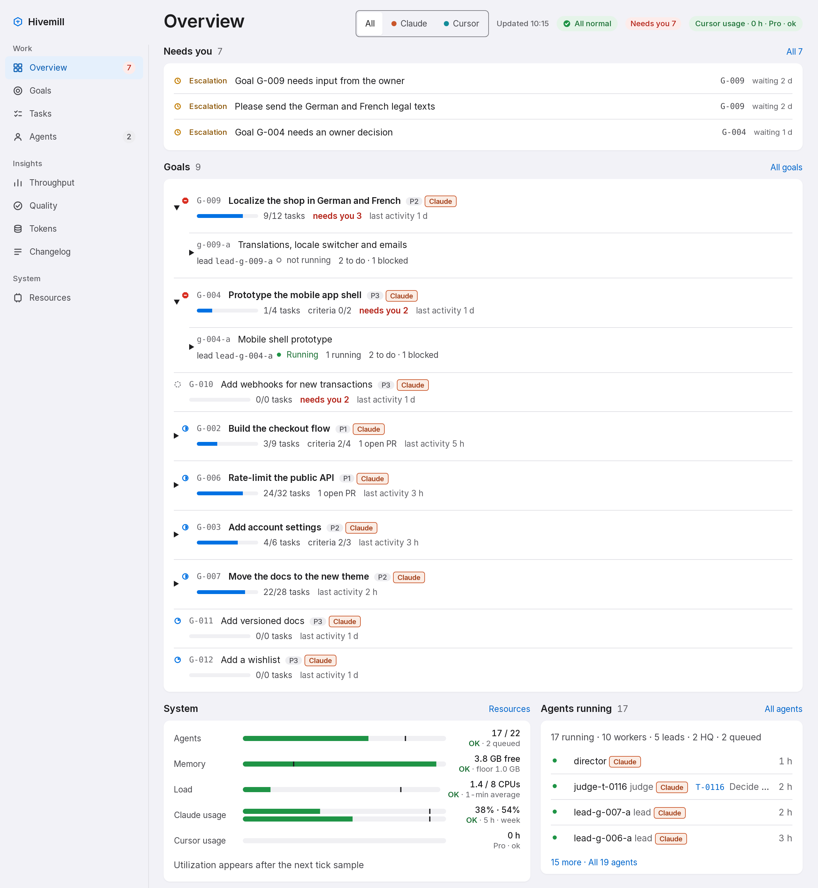
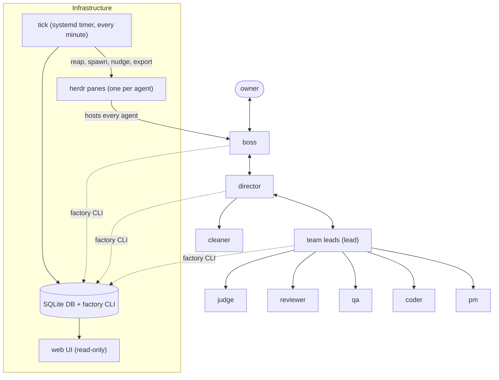
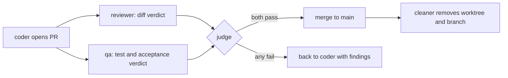
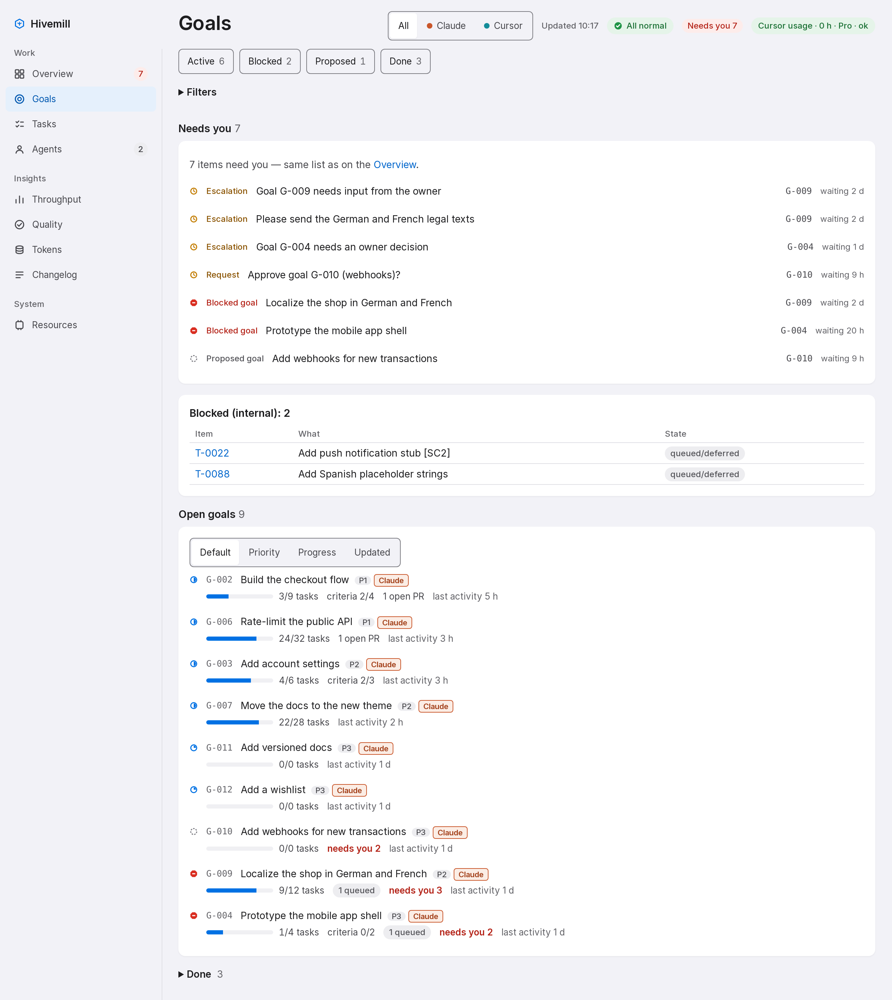
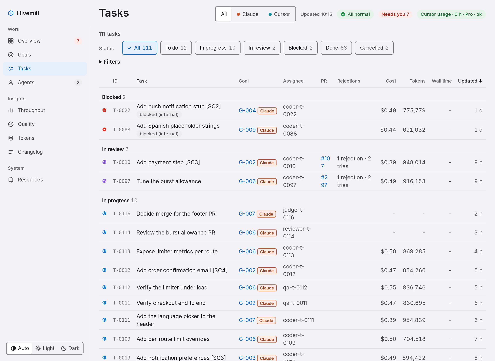
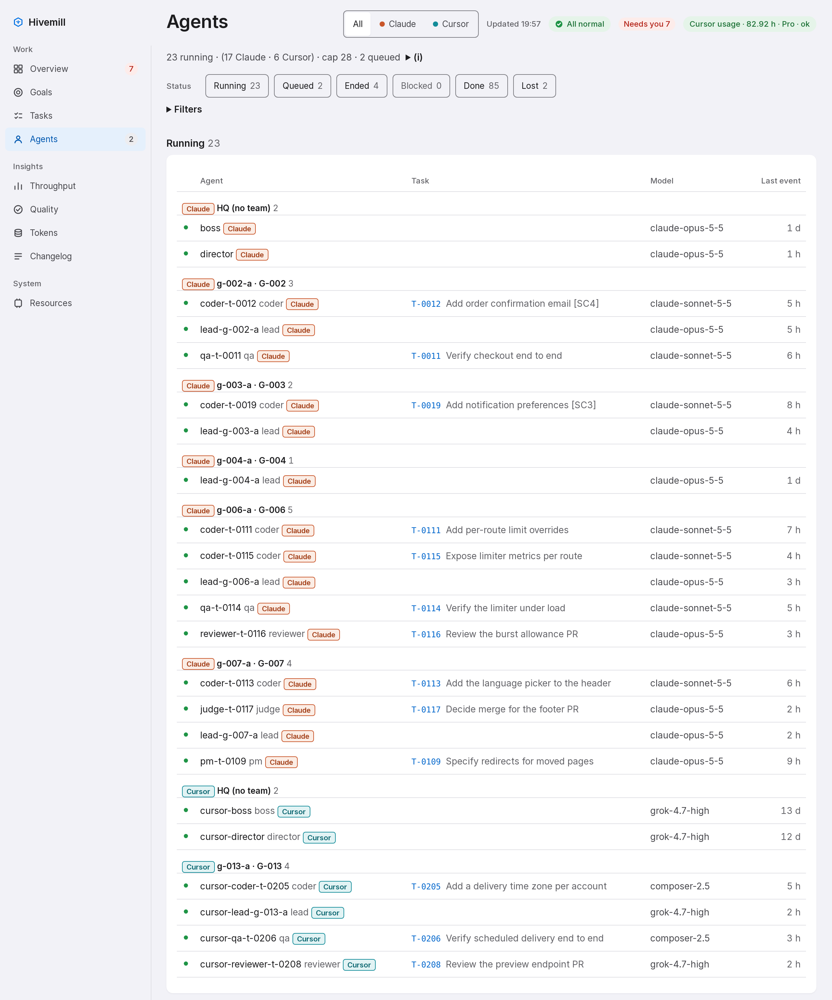
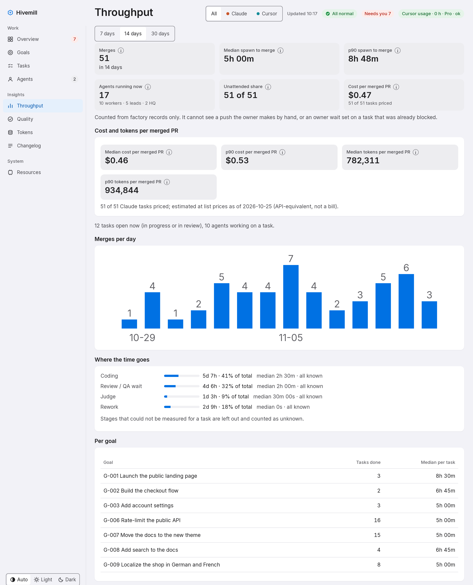
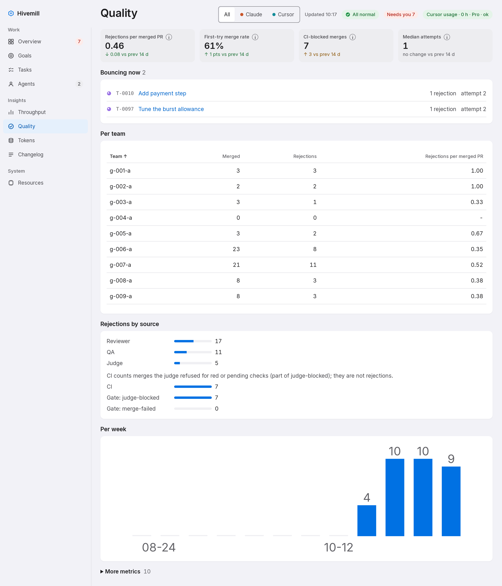
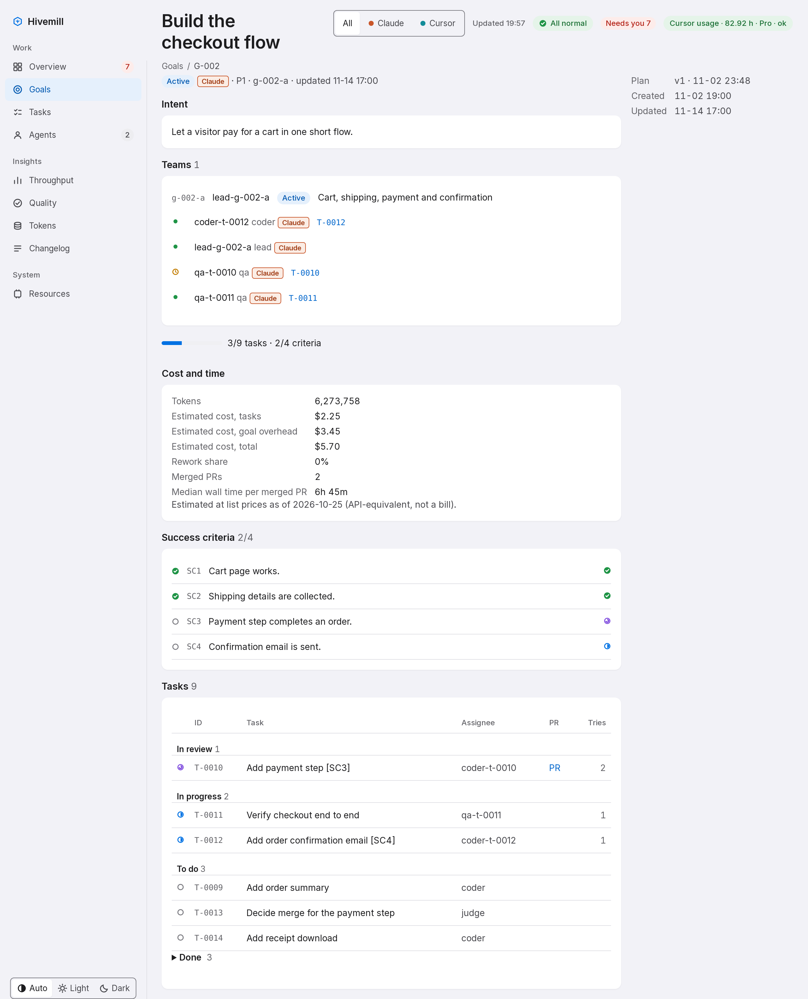

<a id="readme-top"></a>

<!-- README media slots. Each SLOT marker names a block that T-0480 (new screenshots) or T-0708 (video v2) swaps by
     changing only the file path or URL inside it, never the surrounding layout. See docs/readme-media.md. -->

<p align="center"><picture><source media="(prefers-color-scheme: dark)" srcset="docs/images/wordmark-dark.svg"></picture></p>

<h3 align="center">Hivemill is a self-hosted software factory of AI coding agents (Claude Code and Cursor),<br>with separate review, QA and a judge that decides the merge.</h3>

<p align="center">
  <a href="https://github.com/volekerb/hivemill/actions/workflows/tests.yml"></a>
  <a href="LICENSE"></a>
  <a href="docs/SETUP.md"></a>
  <a href="docs/go-toolchain.md"></a>
  <a href="https://github.com/volekerb/hivemill/releases"></a>
</p>

<p align="center">
  <a href="#quickstart"><b>Quickstart</b></a> ·
  <a href="docs/README.md">Docs</a> ·
  <a href="docs/examples/README.md">Examples</a> ·
  <a href="docs/adopt/ADOPT.md">Adopt with Claude</a> ·
  <a href="SECURITY.md">Security</a> ·
  <a href="https://github.com/volekerb/hivemill/discussions">Discussions</a>
</p>

<!-- SLOT:VIDEO (T-0708): replace only the bare user-attachments URL on the next line and keep the links below it. -->
https://github.com/user-attachments/assets/dfec91f4-de05-4592-aaec-3662ce674c4a

<p align="center"><a href="docs/demo/README.md">how it was made</a> · seeded demo data only</p>

<!-- SLOT:HERO (T-0480): one big screenshot. Swap the two paths (light in img src, dark in source srcset) and the alt text. -->
<p align="center">
  <a href="docs/images/home-light.png"><picture>
    <source media="(prefers-color-scheme: dark)" srcset="docs/images/home-dark.png">
    
  </picture></a>
</p>

## What you get

You describe what you want built to one boss agent. A director staffs a team, and a chain of coders, QA, reviewers and a judge ships it as pull requests. The agent that writes a change never reviews, tests or merges it. Hivemill's CLI is `factory`.

<table>
  <tr>
    <td width="33%"><b>Fixed roles</b><br>Each role has its own prompt and permissions, enforced by hooks rather than by trust.</td>
    <td width="33%"><b>Independent review</b><br>A separate reviewer and QA check every pull request against a real test run.</td>
    <td width="33%"><b>A judge merges</b><br>Only on passing reviewer and QA verdicts. Anything else goes back with findings.</td>
  </tr>
  <tr>
    <td><b>One source of truth</b><br>Goals, tasks, messages and verdicts are rows in SQLite with an append-only log.</td>
    <td colspan="2"><b>Small-box friendly</b><br>A spawn gate queues agents until RAM, load and Claude process count allow.</td>
  </tr>
  <tr>
    <td><b>Two runtimes, side by side</b><br>A Claude org and a Cursor org, each a full chain of command, share one box and one DB (<a href="docs/runtimes.md">runtimes</a>).</td>
    <td><b>A read-only web UI</b><br>Goals, agents, throughput, quality, and cost, tokens and wall time per task, in light and dark.</td>
    <td><b>Opt-in containment</b><br>A worker guard on every tool call, an optional sandbox, a GitHub token per worker role and optional per-task clones (<a href="docs/worker-guard.md">guard</a>, <a href="docs/worker-sandbox.md">sandbox</a>).</td>
  </tr>
</table>

## One change, five steps

1. **You ask.** Describe what you want to the boss. It becomes a goal with success criteria.
2. **A team forms.** A director staffs a lead, who plans tasks. Each task gets its own worktree and branch.
3. **A coder builds.** It opens a pull request and stops. It cannot merge or review.
4. **Two others check.** A reviewer reads the diff. QA runs the tests against the acceptance criteria.
5. **A judge decides.** Both pass, it merges. Either fails, it goes back with findings. Every verdict is stored.

The roles and the merge gate as diagrams are under [How it works](#how-it-works).

The factory runs on [herdr](https://herdr.dev), the terminal multiplexer that hosts the agent panes ([source](https://github.com/herdrdev/herdr), pinned release [v0.9.5](https://github.com/herdrdev/herdr/releases/tag/v0.9.5)).

## Quickstart

### Install

Needs a fresh Debian or Ubuntu machine and a logged-in Claude Code (the Cursor org also needs the Cursor Agent CLI, see [docs/runtimes.md](docs/runtimes.md)). In Claude Code:

```
/plugin marketplace add volekerb/hivemill
/plugin install hivemill
/hivemill:setup
```

The full guide, with the installer options and the manual steps, is [docs/SETUP.md](docs/SETUP.md).

### Look around without installing

Seeded fictional data, nothing real runs ([docs/demo-data.md](docs/demo-data.md)). Run from the repository root:

```
export TRIAL=$(mktemp -d)
python3 ci/demo_seed.py --home "$TRIAL/demo" --now 2026-10-25T12:00:00+01:00
HOME=$TRIAL/demo/home FACTORY_HOME=$TRIAL/demo bin/factory serve --bind 127.0.0.1 --port 18624
```

Open <http://127.0.0.1:18624/> to see the read-only web UI on the demo data. In another shell, put `HOME=$TRIAL/demo/home FACTORY_HOME=$TRIAL/demo` in front of `factory goal list` to see the demo goals as a table.

## A task's life in commands

Three walkthroughs with full output on the demo data: [from a goal to a merged PR](docs/examples/01-goal-to-merged-pr.md), [handling a rejection](docs/examples/02-handling-a-rejection.md), [the digest and scorecard](docs/examples/03-digest-and-scorecard.md).

## How it works

- **Separation of roles.** Each role has its own prompt and its own permission settings, enforced by hooks rather than by trust.
- **Two orgs, one box.** An org is a complete chain of command (boss, director, leads, workers) on one runtime and one model map: `claude` (Claude Code, the default) and `cursor` (Cursor Agent). Each goal belongs to one org, every spawn inherits it, and both orgs share one agent cap and one resource gate ([docs/runtimes.md](docs/runtimes.md)).
- **Evidence over claims.** A task is done when a reviewer and QA have checked the PR diff and a real test run, not when an agent says so.
- **Resource-aware on a small box.** A spawn gate watches RAM, load and the number of Claude processes, and queues new agents until there is room. The whole factory runs on one modest VM.
- **Contained workers.** A worker guard hook blocks actions outside a role's job. Opt-in extras: the worker sandbox (`sandbox_roles`), a worker GitHub token per role (`worker_gh_roles`) and a standalone clone per coder task instead of a worktree (`task_clones`, off by default; [docs/git-hardening.md](docs/git-hardening.md)). The guard is Python by default; a Go port is available through `guard_impl` ([docs/worker-guard-go.md](docs/worker-guard-go.md)).
- **Everything auditable.** Goals, plans, tasks, messages, verdicts and decisions are rows in SQLite with an append-only event log, exported to readable markdown every minute.



The merge gate, for every change:



Details: [docs/lifecycle.md](docs/lifecycle.md), [docs/verdict-gates.md](docs/verdict-gates.md), [docs/db-layout.md](docs/db-layout.md).

## Features

| Feature | What it does | Docs |
|---|---|---|
| **Run it** | | |
| Setup and operations | Install, boot units, reboot recovery, identity rules | [SETUP](docs/SETUP.md), [operations](docs/operations.md) |
| Adopt with Claude | An instruction file your own Claude Code follows to install it | [ADOPT](docs/adopt/ADOPT.md) |
| **Ship safely** | | |
| Verdict gates | The judge merges only on passing reviewer and QA verdicts | [verdict-gates](docs/verdict-gates.md) |
| Goal lifecycle | From request to goal to done, with plan and success criteria | [goal-lifecycle](docs/goal-lifecycle.md) |
| **Contain agents** | | |
| Worker guard | Hooks that block actions outside a role's job | [worker-guard](docs/worker-guard.md) |
| Worker sandbox | Opt-in namespaced spawn and worker GitHub tokens, with known limits | [worker-sandbox](docs/worker-sandbox.md) |
| Per-task clones | Optional standalone clone per coder task (`task_clones`) | [git-hardening](docs/git-hardening.md) |
| Stopping a worker | Stop one agent cleanly without losing its work | [stopping-a-worker](docs/stopping-a-worker.md) |
| **Two runtimes** | | |
| Claude and Cursor orgs | Orgs, runtimes, model maps and message routing | [runtimes](docs/runtimes.md) |
| **See it** | | |
| Web UI | Read-only pages for goals, tasks, agents, throughput and quality | [web-ui](docs/web-ui.md) |
| State branch | Markdown exports and a DB dump pushed to the `state` branch | [state-branch](docs/state-branch.md) |

Each feature has its own file under docs/ (all pages: [docs/README.md](docs/README.md)). Also: [tests and CI](docs/tests-and-ci.md), [lessons](docs/lessons.md), [per-role plugins](docs/per-role-plugins.md), [updating persistent agents](docs/updating-persistent-agents.md), [boss mail](docs/boss-mail.md).

<p align="right"><a href="#readme-top">back to top</a></p>

## How it compares

| | One Claude Code session | Hand-run subagents | Hivemill |
|---|---|---|---|
| Role separation | One agent plans, writes and judges its own work | You choose the roles each time | Fixed roles with their own prompts and permissions, enforced by hooks ([worker-guard](docs/worker-guard.md)) |
| Independent review | The author reviews itself | Only if you start a reviewer | A separate reviewer and QA check every PR ([verdict-gates](docs/verdict-gates.md)) |
| Merge gate | You merge by hand | You merge by hand | The judge merges, gated on reviewer and QA ([verdict-gates](docs/verdict-gates.md)) |
| State and audit | The chat transcript | Whatever you wrote down | Goals, tasks, messages and verdicts in SQLite with an append-only event log ([db-layout](docs/db-layout.md)) |
| Resource gate | None | None | A spawn gate queues agents until RAM, load and Claude process count allow ([spawn-queue](docs/spawn-queue.md)) |
| Recovery after reboot | Start over | Start over | Boot units resume the headquarters and active teams ([operations](docs/operations.md)) |

Works with: Claude Code, Cursor Agent, [herdr](https://github.com/herdrdev/herdr), `gh`, systemd user units and the [Moshi](#use-it-from-your-phone) phone app.

## The web UI

A read-only web UI shows goals, tasks, live agents, throughput and quality, in light and dark themes, with an org filter, a runtime chip per agent and cost, tokens and wall time per task. Start it with `factory serve` ([docs/web-ui.md](docs/web-ui.md)). The screenshots come from fictional demo data only ([docs/demo-data.md](docs/demo-data.md)); click one for the full-size light image.

<!-- SLOT:GALLERY (T-0480): six page shots in a 3x2 table; swap paths and alt text only. -->
<table>
  <tr>
    <td align="center" width="33%">
      <a href="docs/images/home-light.png"><picture>
        <source media="(prefers-color-scheme: dark)" srcset="docs/images/home-dark.png">
        
      </picture></a><br>
      <sub><a href="docs/web-ui.md">Overview</a>: agents, PRs, goals and usage</sub>
    </td>
    <td align="center" width="33%">
      <a href="docs/images/goals-light.png"><picture>
        <source media="(prefers-color-scheme: dark)" srcset="docs/images/goals-dark.png">
        
      </picture></a><br>
      <sub><a href="docs/web-ui.md">Goals</a>: status and priority</sub>
    </td>
    <td align="center" width="33%">
      <a href="docs/images/tasks-light.png"><picture>
        <source media="(prefers-color-scheme: dark)" srcset="docs/images/tasks-dark.png">
        
      </picture></a><br>
      <sub><a href="docs/web-ui.md">Tasks</a>: status, assignee and PR</sub>
    </td>
  </tr>
  <tr>
    <td align="center" width="33%">
      <a href="docs/images/agents-light.png"><picture>
        <source media="(prefers-color-scheme: dark)" srcset="docs/images/agents-dark.png">
        
      </picture></a><br>
      <sub><a href="docs/web-ui.md">Agents</a>: live agents by role and team</sub>
    </td>
    <td align="center" width="33%">
      <a href="docs/images/throughput-light.png"><picture>
        <source media="(prefers-color-scheme: dark)" srcset="docs/images/throughput-dark.png">
        
      </picture></a><br>
      <sub><a href="docs/web-ui.md">Throughput</a>: merged changes over time</sub>
    </td>
    <td align="center" width="33%">
      <a href="docs/images/quality-light.png"><picture>
        <source media="(prefers-color-scheme: dark)" srcset="docs/images/quality-dark.png">
        
      </picture></a><br>
      <sub><a href="docs/web-ui.md">Quality</a>: rejections and retries per team</sub>
    </td>
  </tr>
  <tr>
    <td align="center" width="33%">
      <a href="docs/images/goal-light.png"><picture>
        <source media="(prefers-color-scheme: dark)" srcset="docs/images/goal-dark.png">
        
      </picture></a><br>
      <sub><a href="docs/web-ui.md">Goal detail</a>: intent, plan, teams and tasks</sub>
    </td>
  </tr>
</table>

## Status and limits

- An agent is a Claude Code or a Cursor Agent session, depending on its org, so it uses your Claude or Cursor usage. Claude is the default.
- The `hc` (herdr-core) terminal backend is experimental and off by default ([docs/terminal-backends.md](docs/terminal-backends.md)).
- It is built for a single box, not a cluster. State is one SQLite file.
- Agent isolation is a tripwire, not a sandbox. Hooks and permission settings stop honest mistakes and make bypasses visible; they do not contain a determined adversary. Read [SECURITY.md](SECURITY.md) for the threat model and the known limits before you point it at anything you cannot afford to lose.
- The worker sandbox is opt-in (`sandbox_roles`, off by default) and a tripwire, not a boundary: it has no egress filter ([docs/worker-sandbox.md](docs/worker-sandbox.md)).
- The web UI is read-only and has no authentication; bind it to an address you trust.

Not affiliated with Anthropic. Claude and Claude Code are products of Anthropic.

## Use it from your phone

Install [Moshi](https://getmoshi.app) on your phone, connect to your box over SSH, and run `herdr` there to reach the boss's pane. Moshi is a third-party app, not part of Hivemill.

## Resources

- [What's new in v0.4.0](docs/releases/v0.4.0-announcement.md): a short plain-English summary of this release.
- [docs/examples/](docs/examples/README.md): three walkthroughs with real output.
- [docs/README.md](docs/README.md): index of every docs page. [docs/SETUP.md](docs/SETUP.md): install and troubleshooting.
- [docs/finishing-coders.md](docs/finishing-coders.md): how coders finish. [Known gaps](docs/worker-guard.md) of the worker guard.
- [docs/worker-sandbox.md](docs/worker-sandbox.md): worker sandbox design, owner steps, rollout, rollback.
- [docs/adopt/ADOPT.md](docs/adopt/ADOPT.md): let your own Claude Code set it up.
- [CHANGELOG.md](CHANGELOG.md), [SECURITY.md](SECURITY.md), [THIRD_PARTY.md](THIRD_PARTY.md), [CODE_OF_CONDUCT.md](CODE_OF_CONDUCT.md).

## Contributing

Read [CONTRIBUTING.md](CONTRIBUTING.md) first. A feature PR adds or edits its docs/<feature>.md page and does not edit this README. Small, well-scoped places to start are in [docs/STARTER_ISSUES.md](docs/STARTER_ISSUES.md). Report vulnerabilities as described in [SECURITY.md](SECURITY.md).

## License

[MIT](LICENSE). Third-party notices: [THIRD_PARTY.md](THIRD_PARTY.md).

<p align="right"><a href="#readme-top">back to top</a></p>
