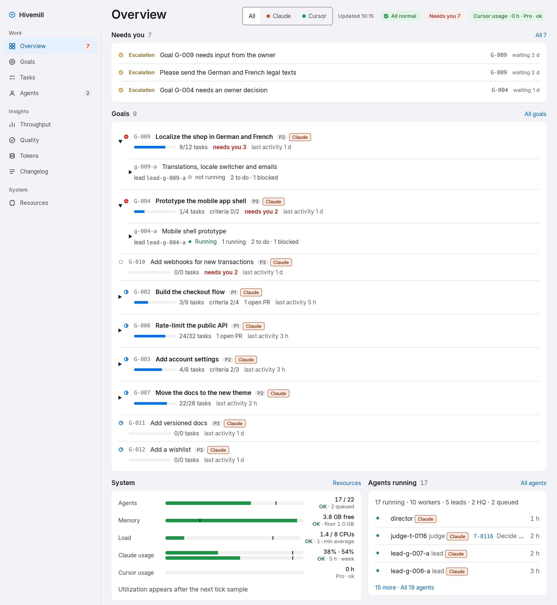
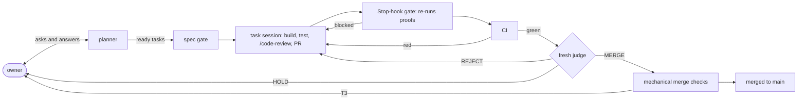
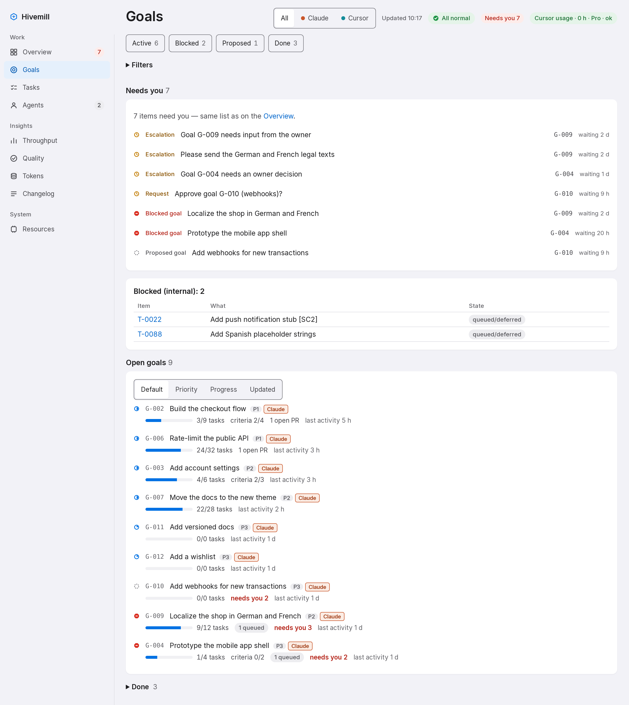
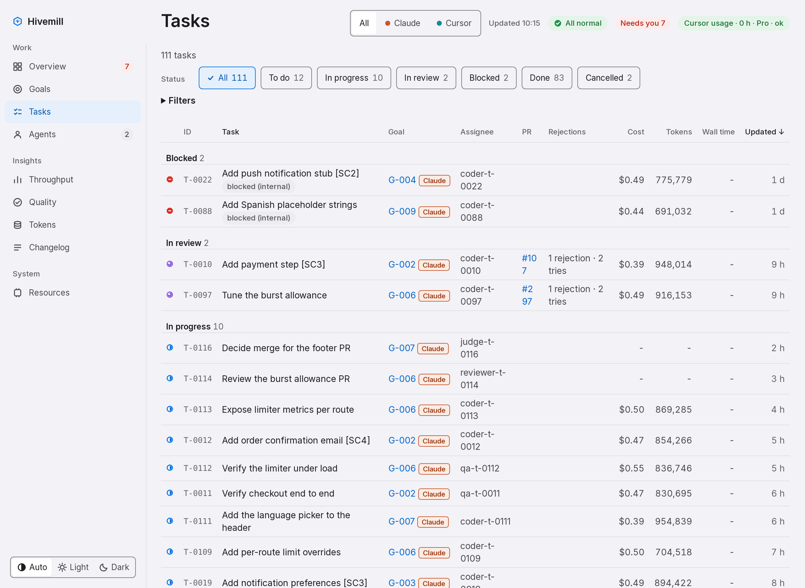
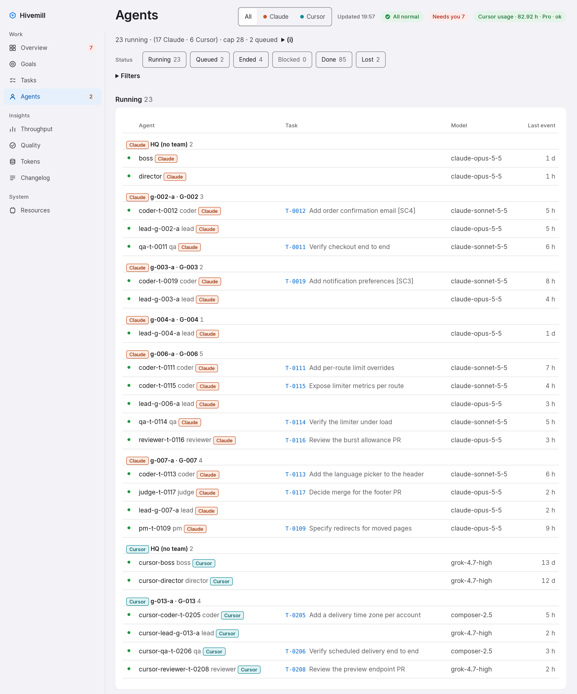
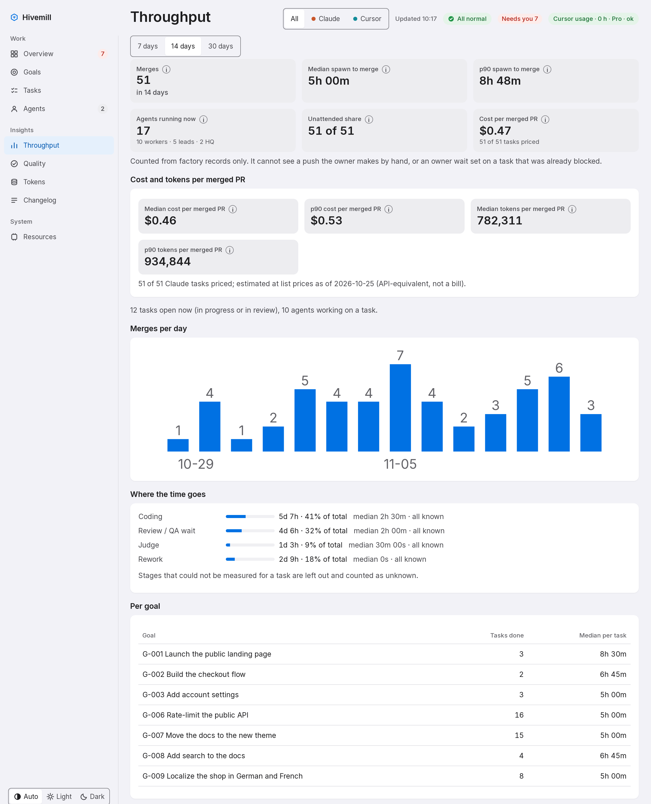
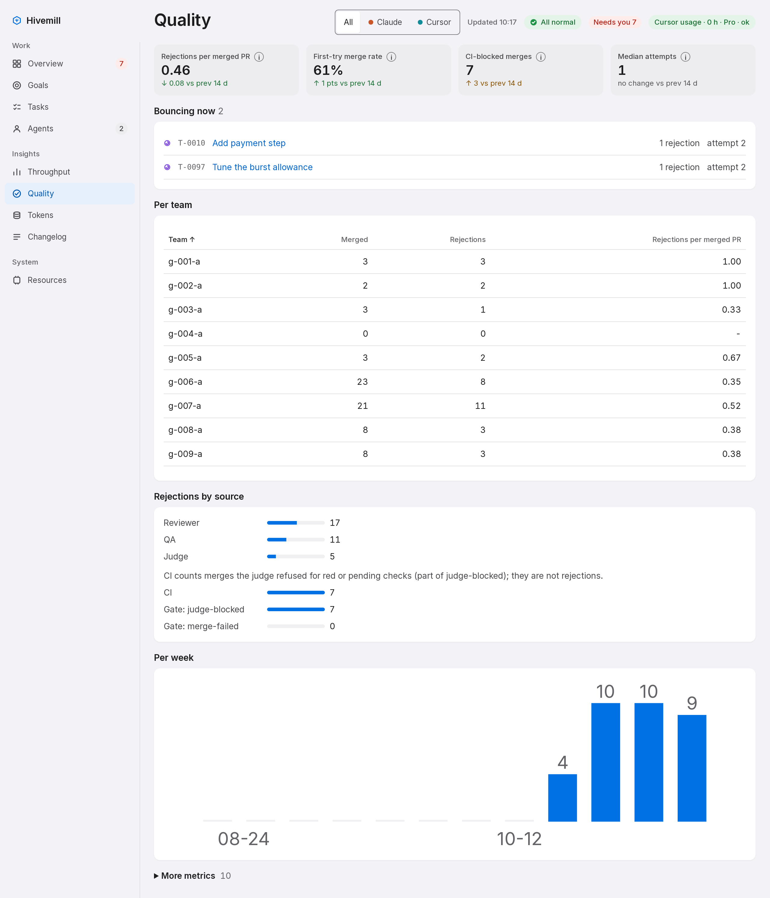
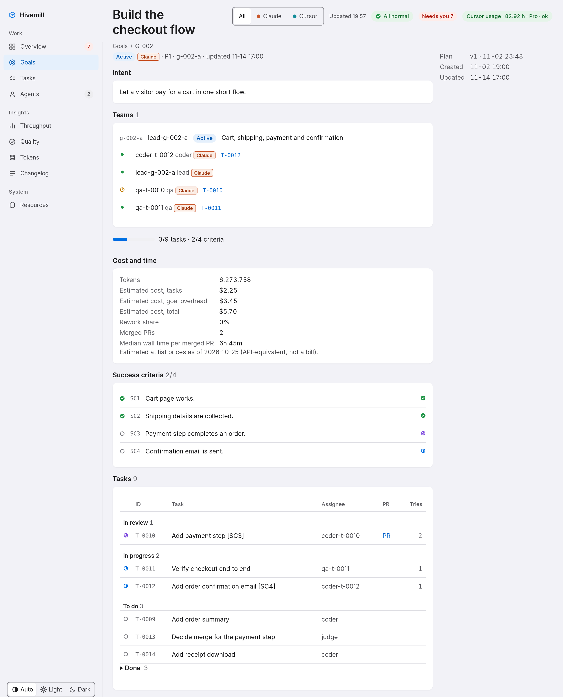
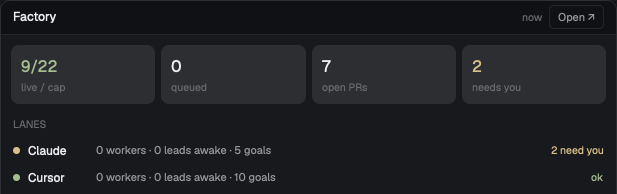

<a id="readme-top"></a>

<!-- README media slots. Each SLOT marker names a block that T-0480 (new screenshots) or T-0708 (video v2) swaps by
     changing only the file path or URL inside it, never the surrounding layout. See docs/readme-media.md. -->

<p align="center"><picture><source media="(prefers-color-scheme: dark)" srcset="docs/images/wordmark-dark.svg"></picture></p>

<h3 align="center">Every merged PR proven against its spec, at a known cost.<br>A self-hosted runner for Claude Code: one session per task, a gate that re-runs the proofs, and a fresh judge.</h3>

<p align="center">
  <a href="https://github.com/volekerb/hivemill/actions/workflows/tests.yml"></a>
  <a href="LICENSE"></a>
  <a href="docs/go-toolchain.md"></a>
  <a href="docs/SETUP.md"></a>
  <a href="https://github.com/volekerb/hivemill/releases"></a>
</p>

<p align="center">
  <a href="#quickstart"><b>Quickstart</b></a> ·
  <a href="docs/option-b-runner.md">How the runner works</a> ·
  <a href="docs/README.md">Docs</a> ·
  <a href="SECURITY.md">Security</a> ·
  <a href="https://github.com/volekerb/hivemill/discussions">Discussions</a>
</p>

<!-- SLOT:VIDEO (T-0708): replace only the bare user-attachments URL on the next line and keep the links below it. -->
https://github.com/user-attachments/assets/dfec91f4-de05-4592-aaec-3662ce674c4a

<p align="center"><a href="docs/demo/README.md">how it was made</a> · seeded demo data only · the film and screenshots show the <a href="#how-it-works">legacy pipeline</a></p>

<!-- SLOT:HERO (T-0480): one big screenshot. Swap the two paths (light in img src, dark in source srcset) and the alt text. -->
<p align="center">
  <a href="docs/images/home-light.png"><picture>
    <source media="(prefers-color-scheme: dark)" srcset="docs/images/home-dark.png">
    
  </picture></a>
</p>

## Where you run and watch it

| Profile | Supervision | Backup | Notes |
|---|---|---|---|
| Laptop | a launchd agent or a terminal running `hivemill daemon` | built-in snapshots, optionally copied to an external disk | runs pause while the laptop sleeps and resume on wake |
| Homelab | a systemd user unit with lingering and a health timer | snapshots to a network share, or Litestream to S3-compatible storage or sftp | an always-on box; you can close your laptop |
| Company | systemd or your service manager on a server | built-in snapshots today | hosted Postgres and workers that pull work are planned, not built |

Sessions run in [herdr-core](https://herdr.dev) (`hc`) terminals that keep running after you log out. A reboot or a lost session is repaired on the next pass. You watch the runner from the terminal: `hivemill run status`, `hivemill report`, `hivemill ask list` and the morning digest (`hivemill digest`). The web UI and the Herdr desktop dashboard show the legacy pipeline, not runner state (see [The web UI](#the-web-ui)).

## What you get

You write a task with acceptance criteria. Each criterion names its proof. Hivemill starts one Claude Code session for the task, checks the work with code before the session may stop, asks a fresh read-only judge whether the diff does what was asked and nothing else, and merges mechanically when every check passes.

There are three AI roles. A deterministic Go runner, `hivemill`, does everything else.

| Role | What it does |
|---|---|
| **Planner** | One long-running session. It keeps each project's queue of ready tasks full, splits tasks that are too big, turns failures into new tasks, and asks you when it needs a decision. |
| **Task session** | One Claude Code session per task. It implements the task, runs the affected tests, runs `/code-review`, fixes the findings and opens the PR. |
| **Judge** | A fresh, read-only session that never wrote the code. It lists every behaviour change in the diff and maps each one to a criterion. It answers MERGE, REJECT or HOLD. |

The runner does the rest, with no model in the loop: the spec gate, the Stop-hook gate that re-runs the proofs, CI rounds, the mechanical merge, budgets and usage caps, the daemon with reconcile and backups, the owner question queue and the morning digest. Each is listed under [Features](#features).

## One change, five steps

1. **You write the spec.** Each acceptance criterion names its proof: `test:`, `cmd:`, `flow:` or `manual:`. The spec gate refuses a task with a criterion that names none. The planner can write and split tasks for you.
2. **One session builds it.** The task session implements the change in its own clone, runs the affected tests, runs `/code-review`, fixes the findings and opens the PR.
3. **Code checks the work.** Before the session may stop, the Stop-hook gate checks the tree, the PR body, the findings and the evidence, and re-runs every `test:` and `cmd:` proof itself. Red CI goes back to the same session.
4. **A fresh judge reads it.** It maps every behaviour change in the diff to a criterion. MERGE, REJECT (back to the same session, two rounds at most) or HOLD (an unasked change, parked for you).
5. **Code merges it.** On MERGE the runner checks the exact head, green checks, the risk tier, main's state and authorship, then merges. A T3 diff waits for you.

## Quickstart

Needs: Linux or macOS, Go 1.27, git, Python 3, a logged-in Claude Code, a logged-in `gh`, and herdr-core (`hc`), which hosts the sessions. Use a checkout of this repository as the runner's home.

```
git clone https://github.com/volekerb/hivemill ~/hivemill
cd ~/hivemill/go && go build -o ~/.local/bin/hivemill ./cmd/hivemill
hivemill init --home ~/hivemill --noreply-email YOU@users.noreply.github.com
export FACTORY_HOME=~/hivemill
hivemill project add app --repo OWNER/NAME --path ~/src/app
```

To run unattended, start `hivemill daemon` under systemd or launchd ([steps](docs/option-b-runner.md#supervision)), turn on the planner with `hivemill planner start`, and let `hivemill config projects app` pick ready tasks. The plugin installer (`/hivemill:setup`) installs the legacy pipeline, not the runner.

## A task's life in commands

```
hivemill goal new --project app --title 'Export filtered orders as CSV'
hivemill task add --goal G-001 --title 'CSV export' --spec-file spec.md --acceptance-file acc.md
hivemill task lint T-0001      # the spec gate
hivemill run T-0001            # start the task, or advance it
hivemill run status            # one line per run
hivemill judge packet T-0001   # what the judge reads
hivemill merge T-0001 --dry-run
hivemill report                # cost, rounds and verdicts per task
```

Acceptance criteria with proofs look like this. A `cmd:` expectation is an exit code, a number, `empty` or text the output must contain:

```
1. one header row and one row per order - cmd:./app export --format csv --fixture tests/orders.json | wc -l => 4
2. an account sees only its own orders - test:tests/test_export.py
3. only the export code changes - cmd:git diff --name-only origin/main...HEAD | grep -vE '^(app/export/|tests/)' => empty
```

## How it works



**Why the judge matters.** The judge does not only check that the asked-for change is there. It must also list every behaviour change in the diff (failure paths, defaults, limits, timers, shared functions) and quote the criterion that asks for each one. A change with no criterion turns a MERGE into a REJECT. A change that is probably fine but was not asked for becomes a HOLD for you. The judge packet also flags files changed outside the task's declared scope. This rule exists because the first version missed things: in the second pilot the judge passed three side effects that no criterion asked for. The fix shipped in [#904](https://github.com/volekerb/hivemill/pull/904) ([ADR 0009](docs/adr/0009-option-b-runner.md#pilot-results)).

**Model choice comes from files, not words.** Sessions run Sonnet 5.5 at medium effort. A task whose declared files, or for the judge whose changed files, match a sensitive path runs Opus 5.5, as does an explicit T3 task.

**The legacy pipeline.** Before the runner, Hivemill was a chain of chat agents: a boss, a director, team leads, pm, coder, reviewer, QA and a judge, run by the Python `factory` CLI and a tick. The runner replaced it ([ADR 0009](docs/adr/0009-option-b-runner.md)). The legacy pipeline is paused, kept as the rollback, and will be removed in its own PR. Its pages are kept and marked legacy in [docs/README.md](docs/README.md). Teams are now projects (`hivemill project add`). Research and design as task kinds are planned.

Details: [docs/option-b-runner.md](docs/option-b-runner.md), [docs/hivemill-planner.md](docs/hivemill-planner.md).

## Features

| Feature | What it does | Docs |
|---|---|---|
| **Gate the work** | | |
| Spec gate | Every criterion names its proof before dispatch (`hivemill task lint`) | [runner](docs/option-b-runner.md#flow) |
| Stop-hook gate | Checks tree, PR body, findings and evidence; re-runs every `test:` and `cmd:` proof | [runner](docs/option-b-runner.md#flow) |
| Judge | Fresh and read-only; maps every behaviour change to a criterion; MERGE, REJECT or HOLD | [runner](docs/option-b-runner.md#flow) |
| Mechanical merge | Judge MERGE on the exact head, green checks, tier T2 or lower, main green, noreply, public text | [runner](docs/option-b-runner.md#flow) |
| **Control cost** | | |
| Budgets | A cap per task, optional caps per project per day and per week | [config keys](docs/option-b-runner.md#config-keys) |
| Usage caps | Holds new runs near the Claude plan's 5-hour and 7-day limits or when memory is low | [config keys](docs/option-b-runner.md#config-keys) |
| Report | Cost per merged PR, hours to merge, rounds, verdicts and proofs per task | [report](docs/option-b-runner.md#event-log-and-report) |
| **Run unattended** | | |
| Daemon | One pass a minute under systemd or launchd, with a health check and alerts | [supervision](docs/option-b-runner.md#supervision) |
| Reconcile | Resumes lost sessions, recreates clones, notices PRs merged by hand | [reconcile](docs/option-b-runner.md#reconcile-and-resume) |
| Backup | SQLite snapshots, file copies or Litestream replication | [backup](docs/option-b-runner.md#backup) |
| **Work with you** | | |
| Planner | Keeps ready queues full, splits tasks, files questions | [planner](docs/hivemill-planner.md) |
| Owner queue | Questions wait in one queue and never block other work (`hivemill ask`) | [owner queue](docs/hivemill-planner.md#owner-queue) |
| Morning digest | Merges, cost, failures, holds and open questions for one day | [digest](docs/hivemill-planner.md#morning-digest) |

Each feature has its own file under docs/ (all pages: [docs/README.md](docs/README.md)).

<p align="right"><a href="#readme-top">back to top</a></p>

## How it compares

| | One Claude Code session | A chain of chat agents | Hivemill runner |
|---|---|---|---|
| Definition of done | The agent says so | Reviewer and QA verdicts | Every `test:` and `cmd:` proof re-run by code, then a judge |
| Unasked changes | Unchecked | Up to the reviewer | Every behaviour change mapped to a criterion, or REJECT or HOLD |
| Merge | You merge by hand | An agent merges | Deterministic checks, then `--match-head-commit` |
| Cost control | None | Agent caps | A budget per task, per project per day and per week, and plan usage caps |
| Sessions per task | 1 | 4–6 | 2 (task and judge) |
| Recovery after a reboot | Start over | Restart the agents | Reconcile resumes the session |

Pilot numbers, against Hivemill's own legacy chain. These are small pilots on Hivemill's own backlog, not a benchmark. Cost is estimated from session transcripts at API list prices, not from invoices.

| | runner | legacy chain |
|---|---|---|
| Cost per merged PR | $1.33 (pilot 1, 4 of 5 merged) and $4.64 (pilot 2, 3 of 6 merged) | $3.56–14 |
| Median time to merge | 0.39 h | 3.4 h |
| PRs needing 2+ rounds | 22% | 50% |

The pilots were 11 tasks. The median and the rounds share cover all 13 runner tasks to date (9 merged), as `hivemill report` printed them on 2026-11-25. `hivemill report` prints the same figures for your own runs.

Works with: Claude Code, `gh`, [herdr-core](https://herdr.dev), systemd or launchd, and the [Moshi](#use-it-from-your-phone) phone app.

## The web UI

The read-only web UI (`factory serve`, [docs/web-ui.md](docs/web-ui.md)) belongs to the legacy pipeline. It reads the legacy tables, so it does not show runner state; use `hivemill report` and `hivemill digest` for that. The screenshots come from fictional demo data only; click one for the full-size light image.

<!-- SLOT:GALLERY (T-0480): six page shots in a 3x2 table; swap paths and alt text only. -->
<table>
  <tr>
    <td align="center" width="33%">
      <a href="docs/images/home-light.png"><picture>
        <source media="(prefers-color-scheme: dark)" srcset="docs/images/home-dark.png">
        
      </picture></a><br>
      <sub><a href="docs/web-ui.md">Overview</a>: agents, PRs, goals and usage</sub>
    </td>
    <td align="center" width="33%">
      <a href="docs/images/goals-light.png"><picture>
        <source media="(prefers-color-scheme: dark)" srcset="docs/images/goals-dark.png">
        
      </picture></a><br>
      <sub><a href="docs/web-ui.md">Goals</a>: status and priority</sub>
    </td>
    <td align="center" width="33%">
      <a href="docs/images/tasks-light.png"><picture>
        <source media="(prefers-color-scheme: dark)" srcset="docs/images/tasks-dark.png">
        
      </picture></a><br>
      <sub><a href="docs/web-ui.md">Tasks</a>: status, assignee and PR</sub>
    </td>
  </tr>
  <tr>
    <td align="center" width="33%">
      <a href="docs/images/agents-light.png"><picture>
        <source media="(prefers-color-scheme: dark)" srcset="docs/images/agents-dark.png">
        
      </picture></a><br>
      <sub><a href="docs/web-ui.md">Agents</a>: live agents by role and team</sub>
    </td>
    <td align="center" width="33%">
      <a href="docs/images/throughput-light.png"><picture>
        <source media="(prefers-color-scheme: dark)" srcset="docs/images/throughput-dark.png">
        
      </picture></a><br>
      <sub><a href="docs/web-ui.md">Throughput</a>: merged changes over time</sub>
    </td>
    <td align="center" width="33%">
      <a href="docs/images/quality-light.png"><picture>
        <source media="(prefers-color-scheme: dark)" srcset="docs/images/quality-dark.png">
        
      </picture></a><br>
      <sub><a href="docs/web-ui.md">Quality</a>: rejections and retries per team</sub>
    </td>
  </tr>
  <tr>
    <td align="center" width="33%">
      <a href="docs/images/goal-light.png"><picture>
        <source media="(prefers-color-scheme: dark)" srcset="docs/images/goal-dark.png">
        
      </picture></a><br>
      <sub><a href="docs/web-ui.md">Goal detail</a>: intent, plan, teams and tasks</sub>
    </td>
  </tr>
</table>

## Herdr desktop dashboard

The Herdr desktop dashboard ([docs/herdr-app-dashboard.md](docs/herdr-app-dashboard.md)) also belongs to the legacy pipeline and reads the same legacy API as the web UI.

<p align="center">
  
  
</p>

## Status and limits

- **Claude Code only.** Every session is Claude Code. A Codex harness is planned.
- **Model judgement remains.** `/code-review` and the judge are model judgement. The gate and the proof re-runs are the deterministic part. `flow:` and `manual:` criteria are not re-run; the report marks those tasks "needs owner check".
- **Not every PR merges by itself.** T3 (high-risk) diffs are never merged mechanically; they wait for you.
- **Sandbox.** The worker guard hook is the security policy. Claude Code's own sandbox is not on yet: on Linux it needs bubblewrap, and macOS support is planned. Isolation is a tripwire, not a boundary. Read [SECURITY.md](SECURITY.md) before you point it at anything you cannot afford to lose.
- **One machine.** State is one SQLite file behind a `Store` interface. Hosted Postgres is planned, not built.
- **Your usage.** Sessions use your Claude plan or API usage. Dollar figures are estimates at API list prices.
- **Install from source.** Build the runner with Go. No release ships the `hivemill` binary yet.

Not affiliated with Anthropic. Claude and Claude Code are products of Anthropic.

## Use it from your phone

Install [Moshi](https://getmoshi.app) on your phone and connect to your box over SSH. Run `hivemill run status` or `hivemill ask list` there, and answer a question with `hivemill ask answer`. Moshi is a third-party app, not part of Hivemill.

<p align="right"><a href="#readme-top">back to top</a></p>

## Resources

- [docs/option-b-runner.md](docs/option-b-runner.md): the runner in full: flow, gate, judge, merge, config keys, daemon, backup and deployment profiles.
- [docs/hivemill-planner.md](docs/hivemill-planner.md): the planner, the owner queue, alerts and the morning digest.
- [docs/adr/0009-option-b-runner.md](docs/adr/0009-option-b-runner.md): the decision record and the pilot results.
- [docs/README.md](docs/README.md): index of every docs page.
- [CHANGELOG.md](CHANGELOG.md), [SECURITY.md](SECURITY.md), [THIRD_PARTY.md](THIRD_PARTY.md), [CODE_OF_CONDUCT.md](CODE_OF_CONDUCT.md).

## Contributing

Read [CONTRIBUTING.md](CONTRIBUTING.md) first. A feature PR adds or edits its docs/<feature>.md page and does not edit this README. Report vulnerabilities as described in [SECURITY.md](SECURITY.md).

## License

[MIT](LICENSE). Third-party notices: [THIRD_PARTY.md](THIRD_PARTY.md).

<p align="right"><a href="#readme-top">back to top</a></p>
