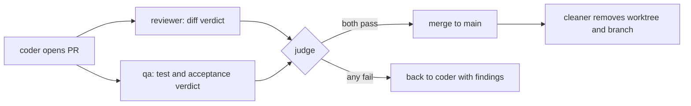

<a id="readme-top"></a>

<!-- README media slots. Each SLOT marker names a block that T-0480 (new screenshots) or T-0708 (video v2) swaps by
     changing only the file path or URL inside it, never the surrounding layout. See docs/readme-media.md. -->

<p align="center"><picture><source media="(prefers-color-scheme: dark)" srcset="docs/images/wordmark-dark.svg"></picture></p>

<h3 align="center">Hivemill is a self-hosted software factory of Claude Code agents,<br>with separate review, QA and a judge that decides the merge.</h3>

<p align="center">
  <a href="https://github.com/volekerb/hivemill/actions/workflows/tests.yml"></a>
  <a href="LICENSE"></a>
  <a href="docs/SETUP.md"></a>
  <a href="https://github.com/volekerb/hivemill/releases"></a>
</p>

<p align="center">
  <a href="#quickstart"><b>Quickstart</b></a> ·
  <a href="docs/README.md">Docs</a> ·
  <a href="docs/examples/README.md">Examples</a> ·
  <a href="docs/adopt/ADOPT.md">Adopt with Claude</a> ·
  <a href="SECURITY.md">Security</a> ·
  <a href="https://github.com/volekerb/hivemill/discussions">Discussions</a>
</p>

<!-- SLOT:VIDEO (T-0708): replace only the bare user-attachments URL on the next line and the MP4 link below it. -->
https://github.com/user-attachments/assets/7615b7c0-48b0-4b44-ad01-aacd7f692583

<p align="center"><a href="https://github.com/volekerb/hivemill/releases/download/v0.1.0/demo.mp4">Download the MP4</a> · <a href="docs/demo/README.md">how it was made</a> · seeded demo data only</p>

<!-- SLOT:HERO (T-0480): one big screenshot. Swap the two paths (light in img src, dark in source srcset) and the alt text. -->
<p align="center">
  <a href="docs/images/home-light.png"><picture>
    <source media="(prefers-color-scheme: dark)" srcset="docs/images/home-dark.png">
    
  </picture></a>
</p>

## What you get

You describe what you want built to one boss agent. A director staffs a team, and a chain of coders, QA, reviewers and a judge ships it as pull requests. The agent that writes a change never reviews, tests or merges it. Hivemill's CLI is `factory`.

<table>
  <tr>
    <td width="33%"><b>Fixed roles</b><br>Each role has its own prompt and permissions, enforced by hooks rather than by trust.</td>
    <td width="33%"><b>Independent review</b><br>A separate reviewer and QA check every pull request against a real test run.</td>
    <td width="33%"><b>A judge merges</b><br>Only on passing reviewer and QA verdicts. Anything else goes back with findings.</td>
  </tr>
  <tr>
    <td><b>One source of truth</b><br>Goals, tasks, messages and verdicts are rows in SQLite with an append-only log.</td>
    <td><b>Small-box friendly</b><br>A spawn gate queues agents until RAM, load and Claude process count allow.</td>
    <td><b>A read-only web UI</b><br>Goals, agents, throughput and quality, in light and dark.</td>
  </tr>
</table>

## One change, five steps

1. **You ask.** Describe what you want to the boss. It becomes a goal with success criteria.
2. **A team forms.** A director staffs a lead, who plans tasks. Each task gets its own worktree and branch.
3. **A coder builds.** It opens a pull request and stops. It cannot merge or review.
4. **Two others check.** A reviewer reads the diff. QA runs the tests against the acceptance criteria.
5. **A judge decides.** Both pass, it merges. Either fails, it goes back with findings. Every verdict is stored.

The roles and the merge gate as diagrams are under [How it works](#how-it-works).

The factory runs on [herdr](https://herdr.dev), the terminal multiplexer that hosts the agent panes ([source](https://github.com/herdrdev/herdr), pinned release [v0.9.5](https://github.com/herdrdev/herdr/releases/tag/v0.9.5)).

## Quickstart

Needs Python 3.11+, git, `gh`, `herdr` and a logged-in Claude Code. Full steps and troubleshooting: [docs/SETUP.md](docs/SETUP.md).

### 1. Look around without herdr or Claude

Seeded fictional data, nothing real runs ([docs/demo-data.md](docs/demo-data.md)). Run from the repository root:

```
export TRIAL=$(mktemp -d)
python3 ci/demo_seed.py --home "$TRIAL/demo" --now 2026-10-25T12:00:00+01:00
HOME=$TRIAL/demo/home FACTORY_HOME=$TRIAL/demo bin/factory serve --bind 127.0.0.1 --port 18624
```

Open <http://127.0.0.1:18624/> to see the read-only web UI on the demo data. In another shell, put `HOME=$TRIAL/demo/home FACTORY_HOME=$TRIAL/demo` in front of `factory goal list` to see the demo goals as a table.

### 2. Run the real factory

Put the CLI on your `PATH` (`~/.local/bin` must exist and be on it), initialise, register a project, bring up the headquarters and open the web UI:

```
git clone https://github.com/volekerb/hivemill.git ~/factory
cd ~/factory
ln -s "$PWD/bin/factory" ~/.local/bin/factory
factory init
factory project add myapp --name "My app" --repo ~/src/myapp --gh example-org/myapp
factory up
factory serve --bind 127.0.0.1
```

`project add` and `up` need a plain shell (workers are refused), a running herdr server and a logged-in Claude Code; the walk-through is in [docs/SETUP.md](docs/SETUP.md). Then open the boss's pane in herdr and describe what you want built.

<details>
<summary>Let Claude set it up</summary>

[docs/adopt/ADOPT.md](docs/adopt/ADOPT.md) is an instruction file for your own Claude Code. It installs the factory step by step, checks each command's output against an expected result, and stops to ask before anything that touches GitHub, git config or your machine outside the checkout. In a fresh checkout, paste this into Claude Code:

```
Read docs/adopt/ADOPT.md in this checkout and set up Hivemill step by step; stop before anything outside the checkout.
```

</details>

<details>
<summary>Try the full CLI against a stub herdr</summary>

[docs/SETUP.md#try-it-without-herdr](docs/SETUP.md#try-it-without-herdr) runs the real CLI and web UI against the stub `herdr` in `tests/stubs/`, including `factory up` and `factory agents`, under a throwaway home. This is also what the fresh-install test follows.

</details>

## A task's life in commands

Three walkthroughs with full output on the demo data: [from a goal to a merged PR](docs/examples/01-goal-to-merged-pr.md), [handling a rejection](docs/examples/02-handling-a-rejection.md), [the digest and scorecard](docs/examples/03-digest-and-scorecard.md).

## How it works

- **Separation of roles.** Each role has its own prompt and its own permission settings, enforced by hooks rather than by trust.
- **Evidence over claims.** A task is done when a reviewer and QA have checked the PR diff and a real test run, not when an agent says so.
- **Resource-aware on a small box.** A spawn gate watches RAM, load and the number of Claude processes, and queues new agents until there is room. The whole factory runs on one modest VM.
- **Everything auditable.** Goals, plans, tasks, messages, verdicts and decisions are rows in SQLite with an append-only event log, exported to readable markdown every minute.


The merge gate, for every change:



Details: [docs/lifecycle.md](docs/lifecycle.md), [docs/verdict-gates.md](docs/verdict-gates.md), [docs/db-layout.md](docs/db-layout.md).

## Features

| Feature | What it does | Docs |
|---|---|---|
| **Run it** | | |
| Setup and operations | Install, boot units, reboot recovery, identity rules | [SETUP](docs/SETUP.md), [operations](docs/operations.md) |
| Adopt with Claude | An instruction file your own Claude Code follows to install it | [ADOPT](docs/adopt/ADOPT.md) |
| **Ship safely** | | |
| Verdict gates | The judge merges only on passing reviewer and QA verdicts | [verdict-gates](docs/verdict-gates.md) |
| Goal lifecycle | From request to goal to done, with plan and success criteria | [goal-lifecycle](docs/goal-lifecycle.md) |
| **Contain agents** | | |
| Worker guard | Hooks that block actions outside a role's job | [worker-guard](docs/worker-guard.md) |
| Worker sandbox | Namespaced spawn for workers, with its known limits | [worker-sandbox](docs/worker-sandbox.md) |
| Stopping a worker | Stop one agent cleanly without losing its work | [stopping-a-worker](docs/stopping-a-worker.md) |
| **See it** | | |
| Web UI | Read-only pages for goals, tasks, agents, throughput and quality | [web-ui](docs/web-ui.md) |
| State branch | Markdown exports and a DB dump pushed to the `state` branch | [state-branch](docs/state-branch.md) |

Each feature has its own file under docs/ (all pages: [docs/README.md](docs/README.md)). Also: [tests and CI](docs/tests-and-ci.md), [lessons](docs/lessons.md), [per-role plugins](docs/per-role-plugins.md), [updating persistent agents](docs/updating-persistent-agents.md), [boss mail](docs/boss-mail.md).

<p align="right"><a href="#readme-top">back to top</a></p>

## How it compares

| | One Claude Code session | Hand-run subagents | Hivemill |
|---|---|---|---|
| Role separation | One agent plans, writes and judges its own work | You choose the roles each time | Fixed roles with their own prompts and permissions, enforced by hooks ([worker-guard](docs/worker-guard.md)) |
| Independent review | The author reviews itself | Only if you start a reviewer | A separate reviewer and QA check every PR ([verdict-gates](docs/verdict-gates.md)) |
| Merge gate | You merge by hand | You merge by hand | The judge merges, gated on reviewer and QA ([verdict-gates](docs/verdict-gates.md)) |
| State and audit | The chat transcript | Whatever you wrote down | Goals, tasks, messages and verdicts in SQLite with an append-only event log ([db-layout](docs/db-layout.md)) |
| Resource gate | None | None | A spawn gate queues agents until RAM, load and Claude process count allow ([spawn-queue](docs/spawn-queue.md)) |
| Recovery after reboot | Start over | Start over | Boot units resume the headquarters and active teams ([operations](docs/operations.md)) |

Works with: Claude Code, [herdr](https://github.com/herdrdev/herdr), `gh`, systemd user units and the [Moshi](#use-it-from-your-phone) phone app.

## The web UI

A read-only web UI shows goals, tasks, live agents, throughput and quality, in light and dark themes. Start it with `factory serve` ([docs/web-ui.md](docs/web-ui.md)). The screenshots come from fictional demo data only ([docs/demo-data.md](docs/demo-data.md)); click one for the full-size light image.

<!-- SLOT:GALLERY (T-0480): six page shots in a 3x2 table; swap paths and alt text only. -->
<table>
  <tr>
    <td align="center" width="33%">
      <a href="docs/images/home-light.png"><picture>
        <source media="(prefers-color-scheme: dark)" srcset="docs/images/home-dark.png">
        
      </picture></a><br>
      <sub><a href="docs/web-ui.md">Overview</a>: agents, PRs, goals and usage</sub>
    </td>
    <td align="center" width="33%">
      <a href="docs/images/goals-light.png"><picture>
        <source media="(prefers-color-scheme: dark)" srcset="docs/images/goals-dark.png">
        
      </picture></a><br>
      <sub><a href="docs/web-ui.md">Goals</a>: status and priority</sub>
    </td>
    <td align="center" width="33%">
      <a href="docs/images/tasks-light.png"><picture>
        <source media="(prefers-color-scheme: dark)" srcset="docs/images/tasks-dark.png">
        
      </picture></a><br>
      <sub><a href="docs/web-ui.md">Tasks</a>: status, assignee and PR</sub>
    </td>
  </tr>
  <tr>
    <td align="center" width="33%">
      <a href="docs/images/agents-light.png"><picture>
        <source media="(prefers-color-scheme: dark)" srcset="docs/images/agents-dark.png">
        
      </picture></a><br>
      <sub><a href="docs/web-ui.md">Agents</a>: live agents by role and team</sub>
    </td>
    <td align="center" width="33%">
      <a href="docs/images/throughput-light.png"><picture>
        <source media="(prefers-color-scheme: dark)" srcset="docs/images/throughput-dark.png">
        
      </picture></a><br>
      <sub><a href="docs/web-ui.md">Throughput</a>: merged changes over time</sub>
    </td>
    <td align="center" width="33%">
      <a href="docs/images/quality-light.png"><picture>
        <source media="(prefers-color-scheme: dark)" srcset="docs/images/quality-dark.png">
        
      </picture></a><br>
      <sub><a href="docs/web-ui.md">Quality</a>: rejections and retries per team</sub>
    </td>
  </tr>
  <tr>
    <td align="center" width="33%">
      <a href="docs/images/goal-light.png"><picture>
        <source media="(prefers-color-scheme: dark)" srcset="docs/images/goal-dark.png">
        
      </picture></a><br>
      <sub><a href="docs/web-ui.md">Goal detail</a>: intent, plan, teams and tasks</sub>
    </td>
  </tr>
</table>

## Status and limits

- Every agent is a Claude Code session, so it uses your Claude usage.
- It is built for a single box, not a cluster. State is one SQLite file.
- Agent isolation is a tripwire, not a sandbox. Hooks and permission settings stop honest mistakes and make bypasses visible; they do not contain a determined adversary. Read [SECURITY.md](SECURITY.md) for the threat model and the known limits before you point it at anything you cannot afford to lose.
- The worker sandbox, which would add real containment, is [in progress](docs/worker-sandbox.md).
- The web UI is read-only and has no authentication; bind it to an address you trust.

Not affiliated with Anthropic. Claude and Claude Code are products of Anthropic.

## Use it from your phone

Install [Moshi](https://getmoshi.app) on your phone, connect to your box over SSH, and run `herdr` there to reach the boss's pane. Moshi is a third-party app, not part of Hivemill.

## Resources

- [docs/examples/](docs/examples/README.md): three walkthroughs with real output.
- [docs/README.md](docs/README.md): index of every docs page. [docs/SETUP.md](docs/SETUP.md): install and troubleshooting.
- [docs/finishing-coders.md](docs/finishing-coders.md): how coders finish. [Known gaps](docs/worker-guard.md) of the worker guard.
- [docs/worker-sandbox.md](docs/worker-sandbox.md): worker sandbox design, owner steps, rollout, rollback.
- [docs/adopt/ADOPT.md](docs/adopt/ADOPT.md): let your own Claude Code set it up.
- [CHANGELOG.md](CHANGELOG.md), [SECURITY.md](SECURITY.md), [THIRD_PARTY.md](THIRD_PARTY.md), [CODE_OF_CONDUCT.md](CODE_OF_CONDUCT.md).

## Contributing

Read [CONTRIBUTING.md](CONTRIBUTING.md) first. A feature PR adds or edits its docs/<feature>.md page and does not edit this README. Small, well-scoped places to start are in [docs/STARTER_ISSUES.md](docs/STARTER_ISSUES.md). Report vulnerabilities as described in [SECURITY.md](SECURITY.md).

## License

[MIT](LICENSE). Third-party notices: [THIRD_PARTY.md](THIRD_PARTY.md).

<p align="right"><a href="#readme-top">back to top</a></p>
