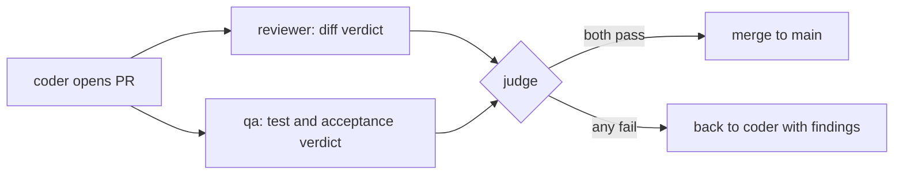

# README option A: Showcase

> **Rationale.** Built for a visitor who lands from a link or a social post and decides in ten seconds whether to keep reading. It leads with the wordmark, one sentence, the demo video and a big screenshot, then a three-by-two feature grid, and pushes the commands below the fold. The trade-off is length of scroll before the first command: someone who wants to install straight away has to jump via the nav links. It is the most "product page" of the three and relies most on images.

<p align="center"><picture><source media="(prefers-color-scheme: dark)" srcset="../../images/wordmark-dark.svg"></picture></p>

<h3 align="center">A self-hosted software factory of Claude Code agents.<br>One boss. Real review. A judge that decides the merge.</h3>

<p align="center">
  <a href="https://github.com/volekerb/hivemill/actions/workflows/tests.yml"></a>
  <a href="../../../LICENSE"></a>
  
  <a href="https://github.com/volekerb/hivemill/releases"></a>
</p>

<p align="center">
  <a href="#quickstart"><b>Quickstart</b></a> ·
  <a href="../../README.md">Docs</a> ·
  <a href="../../examples/README.md">Examples</a> ·
  <a href="../../adopt/ADOPT.md">Adopt with Claude</a> ·
  <a href="../../../SECURITY.md">Security</a>
</p>

https://github.com/user-attachments/assets/7615b7c0-48b0-4b44-ad01-aacd7f692583

<p align="center"><sub>Goal, agents, pull request, merge. Seeded demo data only.</sub></p>

<p align="center">
  <a href="../g-019/shots/overview-light-1280.png"><picture>
    <source media="(prefers-color-scheme: dark)" srcset="../g-019/shots/overview-dark-1280.png">
    
  </picture></a>
</p>

## What you get

You describe what you want built to one boss agent. A director staffs a team, and a chain of coders, QA, reviewers and a judge ships it as pull requests. The agent that writes a change never reviews, tests or merges it.

<table>
  <tr>
    <td width="33%"><b>Fixed roles</b><br>Each role has its own prompt and permissions, enforced by hooks.</td>
    <td width="33%"><b>Independent review</b><br>A separate reviewer and QA check every pull request.</td>
    <td width="33%"><b>A judge merges</b><br>Only on passing reviewer and QA verdicts.</td>
  </tr>
  <tr>
    <td><b>One source of truth</b><br>Goals, tasks, messages and verdicts are rows in SQLite with an append-only log.</td>
    <td><b>Small-box friendly</b><br>A spawn gate queues agents until RAM and load allow.</td>
    <td><b>A read-only web UI</b><br>Goals, agents, throughput and quality, light and dark.</td>
  </tr>
</table>

## Quickstart

Needs Python 3.11+, git, `gh`, `herdr` and a logged-in Claude Code. Full steps: [SETUP](../../SETUP.md).

**Try it with fictional data (no herdr, no Claude):**

```
export TRIAL=$(mktemp -d)
python3 ci/demo_seed.py --home "$TRIAL/demo" --now 2026-10-25T12:00:00+01:00
HOME=$TRIAL/demo/home FACTORY_HOME=$TRIAL/demo bin/factory serve --bind 127.0.0.1 --port 18624
```

**Run the real thing:**

```
git clone https://github.com/volekerb/hivemill.git ~/factory && cd ~/factory
ln -s "$PWD/bin/factory" ~/.local/bin/factory
factory init && factory up
```

## See it work

<table>
  <tr>
    <td align="center" width="33%"><a href="../g-019/shots/goals-light-1280.png"></a><br><sub>Goals</sub></td>
    <td align="center" width="33%"><a href="../g-019/shots/tasks-light-1280.png"></a><br><sub>Tasks</sub></td>
    <td align="center" width="33%"><a href="../g-019/shots/agents-light-1280.png"></a><br><sub>Agents</sub></td>
  </tr>
</table>

## How a change ships



Deep dives: [lifecycle](../../lifecycle.md) · [verdict gates](../../verdict-gates.md) · [database layout](../../db-layout.md).

## Honest limits

Every agent is a Claude Code session and uses your Claude usage. One box, one SQLite file, not a cluster. Isolation is a tripwire, not a sandbox: read [SECURITY](../../../SECURITY.md) first.

## Contributing

Start with [CONTRIBUTING](../../../CONTRIBUTING.md) and the [starter issues](../../STARTER_ISSUES.md). MIT licensed. Not affiliated with Anthropic.
