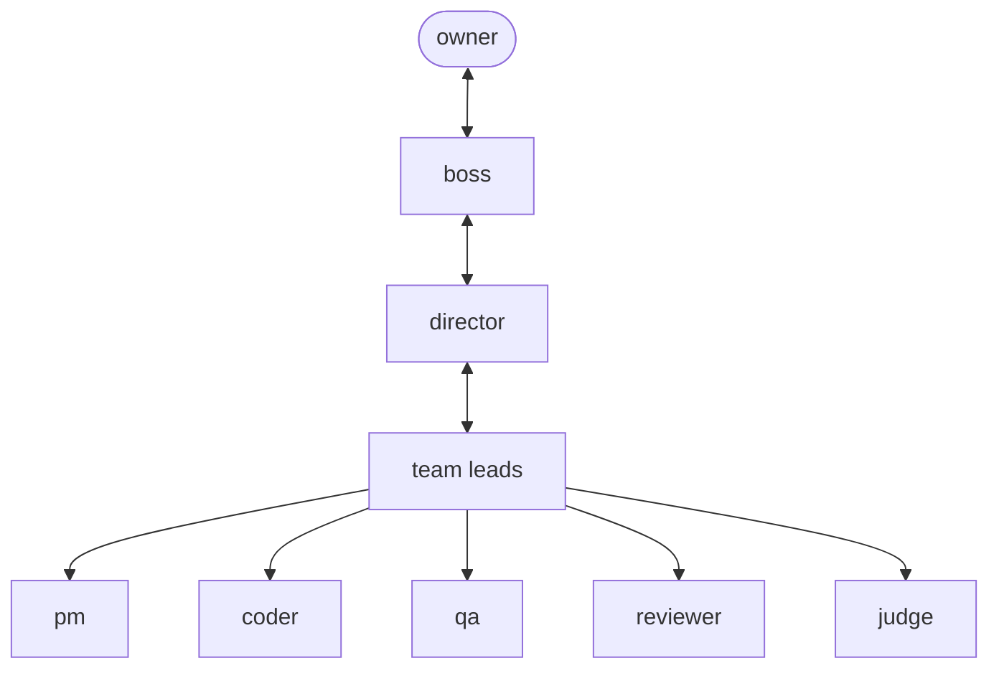
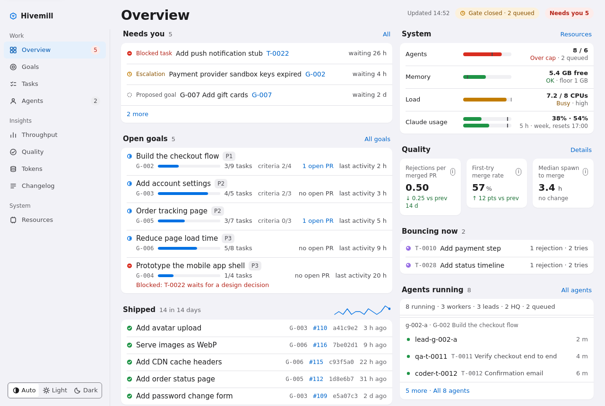
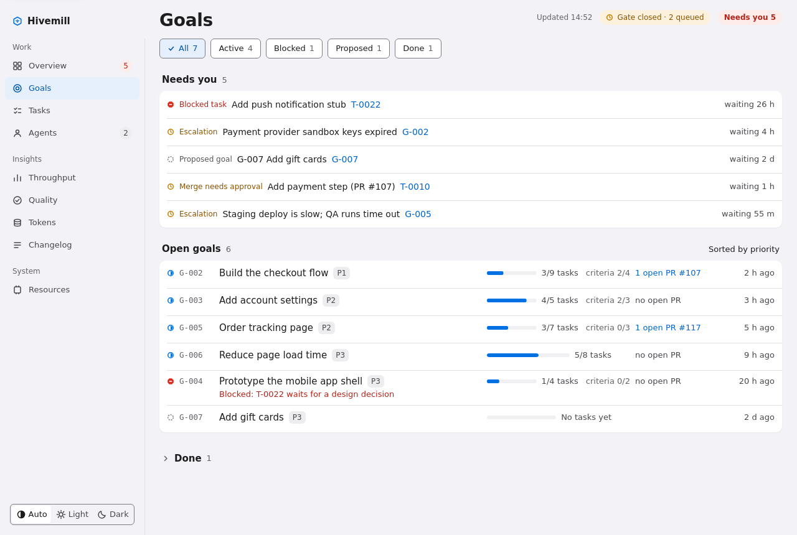
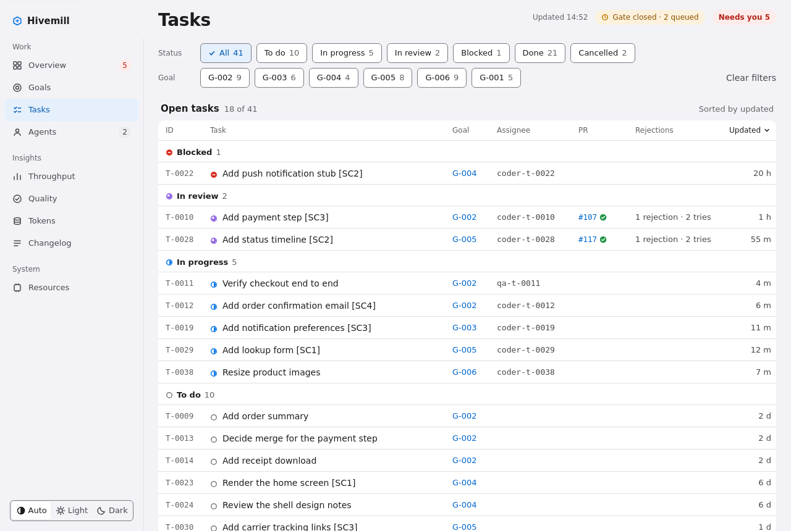
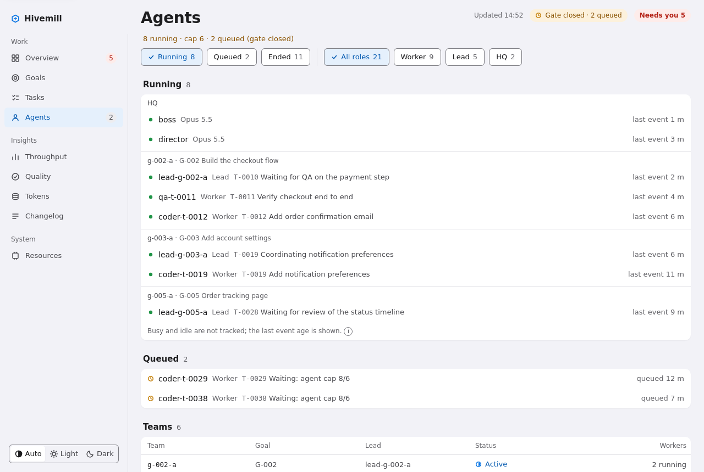
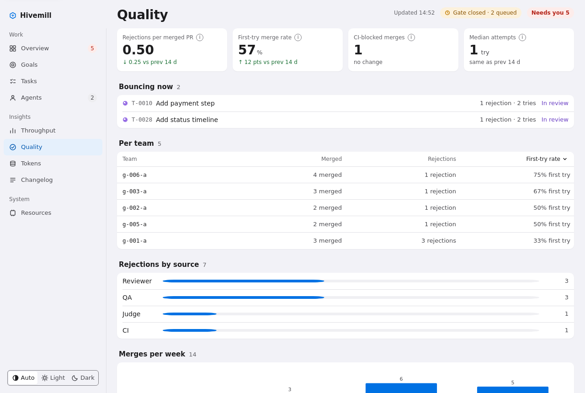
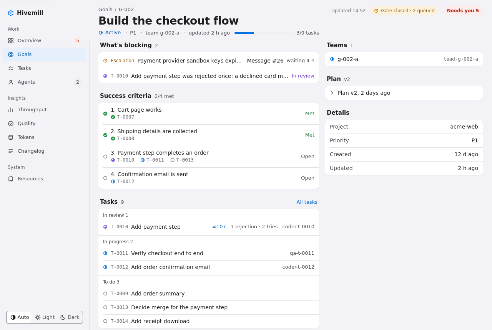

# README option B: Docs-first

> **Rationale.** Built for an engineer who is evaluating the project and wants answers fast: what is it, how do I run it, how is it put together. It opens with a compact header, a one-line summary and a table of contents, shows a small screenshot strip, and puts the quickstart before anything else. The trade-off is that it looks plainer and tells less of a story; the video moves down the page. It is the closest to today's README, only tighter, and the easiest to keep accurate.

# Hivemill

[](https://github.com/volekerb/hivemill/actions/workflows/tests.yml)
[](../../../LICENSE)

[](https://github.com/volekerb/hivemill/releases)

**A self-hosted software factory of Claude Code agents, with review, QA and a judge merge gate.** The CLI is `factory`.

| Quickstart | Architecture | Web UI | Docs | Security |
|:--|:--|:--|:--|:--|
| [Run it](#quickstart) | [How it fits](#architecture) | [Screenshots](#web-ui) | [Index](../../README.md) | [Threat model](../../../SECURITY.md) |

- [What it does](#what-it-does)
- [Quickstart](#quickstart)
- [Architecture](#architecture)
- [Web UI](#web-ui)
- [Demo video](#demo-video)
- [Limits](#limits)
- [Contributing](#contributing)

## What it does

1. You tell the **boss** agent what you want built.
2. The **director** staffs a team under a **lead**.
3. **Coders** open pull requests; a separate **reviewer** and **QA** check each one.
4. A **judge** merges only when both pass.

Everything, from goals to verdicts, is a row in one SQLite database behind the `factory` CLI.

## Quickstart

Needs Python 3.11+, git, `gh`, `herdr` and a logged-in Claude Code. Troubleshooting: [SETUP](../../SETUP.md).

```
git clone https://github.com/volekerb/hivemill.git ~/factory
cd ~/factory
ln -s "$PWD/bin/factory" ~/.local/bin/factory
factory init
factory project add myapp --name "My app" --repo ~/src/myapp --gh example-org/myapp
factory up
factory serve --bind 127.0.0.1
```

No herdr or Claude yet? Browse seeded fictional data first:

```
export TRIAL=$(mktemp -d)
python3 ci/demo_seed.py --home "$TRIAL/demo" --now 2026-10-25T12:00:00+01:00
HOME=$TRIAL/demo/home FACTORY_HOME=$TRIAL/demo bin/factory serve --bind 127.0.0.1 --port 18624
```

> [!TIP]
> Prefer to let Claude do it? [ADOPT](../../adopt/ADOPT.md) is an instruction file your own Claude Code follows step by step.

## Architecture



| Layer | Role |
|---|---|
| Agents | One Claude Code session per role, hosted in herdr panes |
| State | SQLite plus the `factory` CLI ([db-layout](../../db-layout.md)) |
| Gate | Reviewer and QA verdicts, judge merges ([verdict-gates](../../verdict-gates.md)) |
| Guard | Hooks block actions outside a role ([worker-guard](../../worker-guard.md)) |
| Ticker | A systemd timer reaps, spawns, nudges and exports every minute |

## Web UI

Read-only, light and dark. [Details](../../web-ui.md).

| Overview | Goals | Tasks |
|:--:|:--:|:--:|
|  |  |  |
| **Agents** | **Quality** | **Goal detail** |
|  |  |  |

## Demo video

<details>
<summary>Watch the demo</summary>

https://github.com/user-attachments/assets/7615b7c0-48b0-4b44-ad01-aacd7f692583

</details>

## Limits

- Every agent uses your Claude usage. Single box, single SQLite file.
- Isolation is a tripwire, not a sandbox ([SECURITY](../../../SECURITY.md)).
- The web UI is read-only and has no authentication; bind it to an address you trust.

## Contributing

Read [CONTRIBUTING](../../../CONTRIBUTING.md); small tasks are in [STARTER_ISSUES](../../STARTER_ISSUES.md). MIT licensed. Not affiliated with Anthropic.
