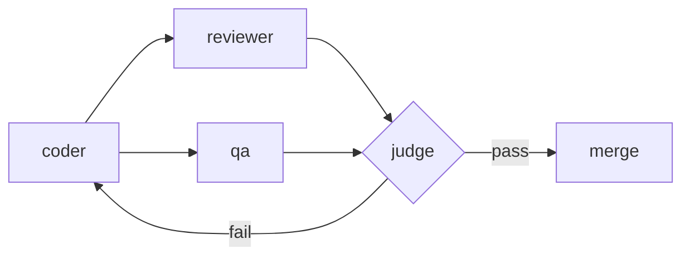
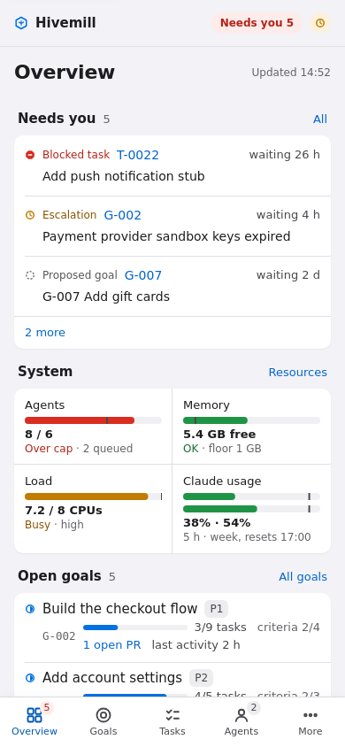
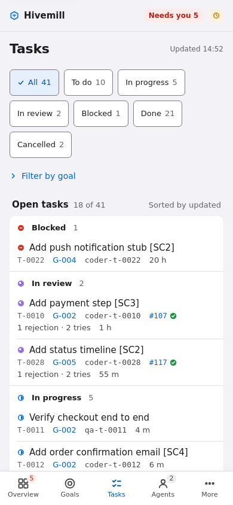
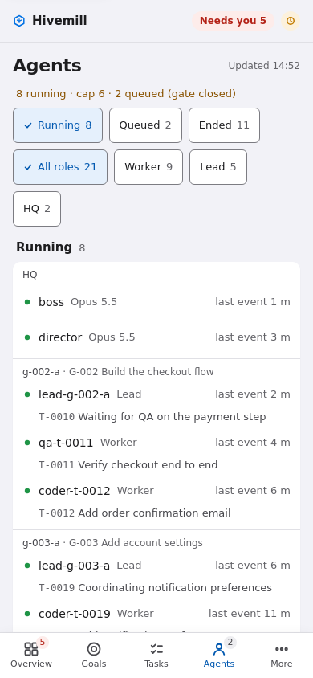

# README option C: The loop

> **Rationale.** Built for the curious reader who wants to understand why this is different from "one agent with subagents". The page is organised around the idea that nobody marks their own homework: a one-line pitch, a numbered walk through a change's life with a screenshot at each stage, then a comparison table. The phone-width screenshots show it works on a small screen. The trade-off is that install instructions come late and the page is opinionated; it sells the design more than the setup, so it links to the setup guide prominently up top.

<div align="center">

<picture><source media="(prefers-color-scheme: dark)" srcset="../../images/wordmark-dark.svg"></picture>

### The agent that writes the code never merges it.

Hivemill is a self-hosted factory of Claude Code agents with separate review, QA and a merge gate.

[](https://github.com/volekerb/hivemill/actions/workflows/tests.yml)

[](../../../LICENSE)
[](https://github.com/volekerb/hivemill/releases)

**[Get started ›](../../SETUP.md)** &nbsp;·&nbsp; [Examples](../../examples/README.md) &nbsp;·&nbsp; [Adopt with Claude](../../adopt/ADOPT.md) &nbsp;·&nbsp; [Security](../../../SECURITY.md)

</div>

https://github.com/user-attachments/assets/7615b7c0-48b0-4b44-ad01-aacd7f692583

## One change, five steps

### 1. You ask

Describe what you want to the boss. It becomes a goal with success criteria.

### 2. A team forms

A director staffs a lead, who plans tasks. Each task gets its own worktree and branch.

<a href="../g-019/shots/goal-light-1280.png"></a>

### 3. A coder builds

The coder opens a pull request and stops. It cannot merge or review.

### 4. Two others check

A reviewer reads the diff. QA runs the tests against the acceptance criteria.

<a href="../g-019/shots/quality-light-1280.png"></a>

### 5. A judge decides

Both pass, it merges. Either fails, it goes back with findings. Every verdict is stored.



## On your phone too

<table>
  <tr>
    <td align="center"></td>
    <td align="center"></td>
    <td align="center"></td>
  </tr>
</table>

## How it compares

| | One session | Hand-run subagents | Hivemill |
|---|---|---|---|
| Who reviews | The author | Only if you remember to | A separate reviewer and QA |
| Who merges | You | You | The judge, gated on verdicts |
| Audit trail | A chat transcript | Whatever you wrote down | SQLite with an append-only log |

## Try it

```
export TRIAL=$(mktemp -d)
python3 ci/demo_seed.py --home "$TRIAL/demo" --now 2026-10-25T12:00:00+01:00
HOME=$TRIAL/demo/home FACTORY_HOME=$TRIAL/demo bin/factory serve --bind 127.0.0.1 --port 18624
```

Seeded fictional data; no herdr or Claude needed. For the real install see [SETUP](../../SETUP.md).

## Under the hood

One SQLite file behind the `factory` CLI holds every goal, task and verdict. Hooks block each role from actions outside its job, and a ticker spawns agents when the box has room. See [lifecycle](../../lifecycle.md) and [db-layout](../../db-layout.md).

## Good to know

Every agent is a Claude Code session and uses your usage. One box, one SQLite file. Isolation is a tripwire, not a sandbox ([SECURITY](../../../SECURITY.md)).

## Contributing

[CONTRIBUTING](../../../CONTRIBUTING.md) · [Starter issues](../../STARTER_ISSUES.md) · MIT licensed · Not affiliated with Anthropic.
