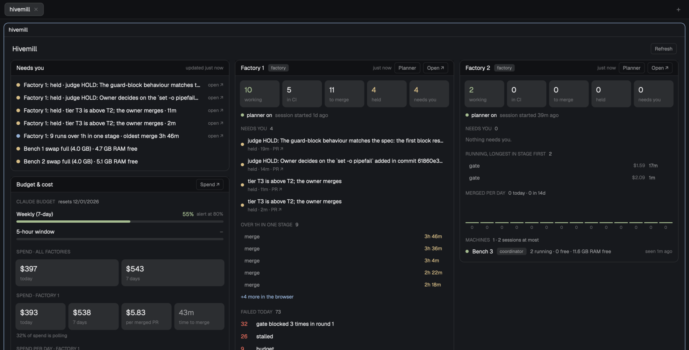
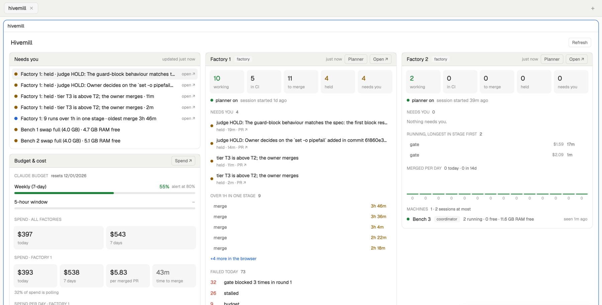
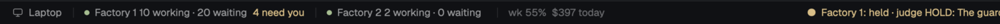

# Hivemill dashboard in the Herdr app

If you use the [Herdr app](https://herdr.dev) (the desktop client of herdr-core), Hivemill can live inside it. The dashboard shows every factory you run. A factory is one hivemill runner with its own `hivemill obs` server.

- **A status bar** across the bottom of the window. One segment per factory (`Workshop 11 working · 14 waiting  2 need you`), then Claude weekly usage and today's spend, and on the right the most urgent alert. Clicking it opens the dashboard.
- **A dashboard tab** with these cards:
  - **Needs you:** one list over all factories and this computer. Open owner questions, runs held for you with the reason, an unreachable factory, a machine that is down, runs long in one stage, an agent waiting on a person.
  - **One card per factory:** runs working, in CI (waiting for it), waiting to merge, held, and what needs you; the planner; what needs you, each line a link to the PR or the task; runs over the stuck limit; today's failed runs by reason; the longest-running runs; merges per day; the factory's machines.
  - **Budget & cost:** Claude 7-day and 5-hour usage, spend today and over 7 days (all factories and each one), cost per merged PR, time to merge, spend per day and the most expensive tasks.
  - **Machines:** this computer and each `hc machine ls` machine: reachable or not, OS and CPUs, uptime, agents, and memory, load, disk and swap.






The pictures are taken in demo mode, so factories and machines carry generic names and task ids are left out.

The app's own agents list already shows every agent, so the dashboard does not repeat it. New alerts also appear as notifications; clicking one opens the dashboard.

This is a Herdr app mod: JavaScript the app runs natively, not a web view. It only reads. Its source is each factory's obs API (`/api/obs/now`, `flow`, `machines`, `spend`, `task`), described in [hivemill-observability.md](hivemill-observability.md). The design behind it is [design/multi-factory.md](design/multi-factory.md).

## Install

Run this on the machine where you use the Herdr app. That can be your laptop rather than a factory's box. Open the app once first.

```sh
python3 plugins/hivemill/scripts/install.py --herdr-app --dry-run   # show the plan
python3 plugins/hivemill/scripts/install.py --herdr-app --yes --factory Workshop=http://HOST:7461 --factory Pilot=http://HOST2:7461
```

It changes three things and nothing else:

| Path | What |
|---|---|
| `~/.config/herdr-app/mods/hivemill/` | the mod (`main.js`, `data.js`, `mod.json`), copied from `plugins/hivemill/herdr-app/mods/hivemill/` |
| `~/.config/herdr-app/layouts/hivemill.json` | a copy of the app's `main` layout, with its status bar replaced by the Hivemill bar |
| `~/.config/hivemill/dashboard.json` | the settings below. A re-run keeps them; `--factory` replaces the list of factories. |

`--factory [LABEL=]URL` names one factory's obs address; repeat it per factory. Without it, the list in the settings stays, and a new settings file gets `http://127.0.0.1:7461`. Settings of the older dashboard (`factory`, `teams`, `orgs`) are removed with a note: they named a server that no longer runs.

When the app is running, the installer then switches it to the Hivemill layout. `--no-sidebar` hides the sidebar in that layout, for a machine kept for screenshots. `ctrl-shift-l` switches layouts, so you can go back to Herdr's own at any time. To uninstall, delete the first two paths.

Exit codes:

- `0`: done, with a last line of `RESULT PASS herdr-app ...`.
- `2`: a usage error.
- `3`: the Herdr app is not set up on this machine.
- `1`: a step failed, with a last line of `RESULT FAIL step=herdr-app-<step>`.

## Where a factory is

Each factory runs `hivemill obs`, on port 7461 and on `127.0.0.1` unless its config key `obs_listen` says otherwise ([hivemill-observability.md](hivemill-observability.md)). Pick one of these per factory:

| Your setup | Settings entry |
|---|---|
| The app runs on the factory's box | `{ "url": "http://127.0.0.1:7461" }` |
| The factory's obs listens on your network (`obs_listen`) | `{ "url": "http://HOST:7461" }` |
| The factory's box is an `hc` machine in the app, and its obs stays on loopback | `{ "url": "http://127.0.0.1:7461", "machine": "NAME" }`. The dashboard asks from that machine, so no port is opened. Add `web_url` if your browser can reach the pages. |

## Settings: `~/.config/hivemill/dashboard.json`

The dashboard rereads this file every minute. A file it cannot parse shows up as an alert. The full example is in [`plugins/hivemill/herdr-app/dashboard.example.json`](../plugins/hivemill/herdr-app/dashboard.example.json).

| Key | Default | Meaning |
|---|---|---|
| `factories` | one entry, `http://127.0.0.1:7461` | one entry per factory, see below |
| `projects` | `[]` | spaces whose agents' screens are read for a wait on a person, see below |
| `usage_file` | `null` | a JSON file with `five_hour_pct`, `seven_day_pct`, `seven_day_resets_at` and `updated_at`: this machine's Claude usage. Without it the Claude meters are not shown. A file over an hour old is shown as old and raises no alert. |
| `alerts.usage_warn_pct` / `usage_danger_pct` | `80` / `90` | Claude weekly usage alerts |
| `alerts.factory_down_minutes` | `5` | alert when a factory has not answered for this long |
| `alerts.stale_minutes` | `3` | a factory's last answer older than this is marked as last known, and raises no alert of its own |
| `alerts.context_below_pct` | `10` | alert when a scanned agent's context left is under this |
| `machines` | `"auto"` | the machines in the Machines card: `"auto"` (this computer and every `hc machine ls` machine), or a list of names with `"local"` for this computer |
| `machine_labels` | `{}` | display names, by `hc machine ls` name, by the machine name a factory reports, and `"local"` for this computer |
| `context_pattern` | `ctx (\d+)% left` | a regex with one group: the context percent, as your agents' status line prints it |
| `demo` | off | screens for docs, see below |

### Factories

```json
"factories": [
  { "label": "Workshop", "url": "http://HOST:7461", "space": "buildbox/hivemill" },
  { "label": "Pilot", "url": "http://127.0.0.1:7461", "machine": "macmini", "web_url": "http://HOST2:7461" }
]
```

- `url`: where that factory's `hivemill obs` answers, as seen from `machine`, or from here when no machine is set.
- `label`: the factory's name on this computer. Without it: the label of its `machine`, else "Factory N". No name is ever taken from a host name.
- `machine`: an `hc machine ls` name. When set, the requests run there (`curl` on that machine).
- `web_url`: the address the "Open" links and task links use. It defaults to `url` when no machine is set.
- `space`: the Herdr space of the factory's planner, `machine/space` for a space on an `hc` machine. The card's "Planner" button selects it.

### What the numbers mean

| On the card | From the factory |
|---|---|
| working | runs in the stages `dispatched`, `gate` or `judge` |
| in CI, to merge | runs waiting for CI (stage `ci`) and runs waiting to merge (stage `merge`). The bar adds these and held as "waiting". |
| held | runs held for the owner. The reason and the PR come from the run's trace. |
| needs you | open owner questions plus held runs |
| planner on / off | the last event of the planner's session: off after `session.ended` |
| over 1h in one stage | the Flow page's "stuck now" list. One alert line per factory, no notification. |
| failed today | runs that ended as `FAIL` since midnight UTC, grouped by the first words of the reason |
| merged per day | merged PRs per UTC day, 14 days |
| spend, per merged PR, time to merge | the factory's totals over all its projects |

A click on a task opens its session's terminal when one is open in the app, else its trace page in the browser. A held run opens its PR.

### No stale numbers

Every factory is asked on its own, so one that is slow or down never blanks another. The card says how old its data is:

- **live:** answered within `alerts.stale_minutes`.
- **last known:** the factory stopped answering. The numbers stay, muted and marked with their age, and they raise no alerts. After `alerts.factory_down_minutes` there is one `<label> unreachable` alert.
- **has not answered:** no numbers at all, only the error.

### Projects: agents that wait on a person

```json
"projects": [{ "name": "My app", "space": "macmini/my-app",
  "wait_patterns": [{ "match": "NEEDS REVIEW", "clear": "REVIEWED", "label": "waits for a review", "after_min": 15 }] }]
```

- `space`: the Herdr space (id or name) whose agents are read. A space on an `hc` machine is written `machine/space`. An unprefixed name means this computer's space; if this computer has none of that name and exactly one remote space has, that one is used.
- `wait_patterns`: text on an agent's screen that means it waits on a person. An idle agent showing `match` (and not `clear`) for `after_min` minutes raises an alert, written with the machine's label: `Mac mini · my-app-w1 waits for a review · 16m`.

The dashboard reads the screens of this computer's agents and of the agents in every space a project names (`hc read <address> --lines 30`). An expired login and a nearly full context window raise alerts too. Agents in other remote spaces are not read.

### Demo mode: screens for docs and films

```json
"demo": { "enabled": true, "hide": ["a private word", "another"], "alerts": true }
```

- Factories are "Factory N" and machines are their `machine_labels` values, else "This computer" and "Machine N". A label that contains a `hide` word falls back to the generic name.
- Task ids, project names and the most expensive tasks are left out.
- Any alert whose text contains a `hide` word is left out. `"alerts": false` shows none.

Turn it off again after the pictures. The Herdr app draws only while its window is on screen, so bring it forward before `herdr-app shot`.

## How it works

- One copy of the mod at a time does the polling, using a short lease in the app's shared state. Every copy reads the same data. The bar and the tab never poll twice.
- The polling intervals: each factory's Now every 30 s, its machines every minute, its Flow every 2 minutes and its spend every 5 minutes; the usage file and the machine probes every minute; agent screens every 2 minutes.
- Only a small part of each answer is kept. The task list of Flow is read for today's failures and dropped.
- The mod's data layer has node tests: `node --test plugins/hivemill/herdr-app/tests/*.test.mjs` (with node 24 the files must be named; a directory does not work). `tests/test_herdr_app_dashboard.py` runs them when node is installed.
- `herdr-app check ~/.config/herdr-app/mods/hivemill` loads the mod once and reports errors.

## Limits

- An open question shows as a count per project. Its text is not in the obs API yet.
- A failed run that the planner already re-filed still counts in "failed today".
- The runner's dollar caps (`weekly_budget_usd`, `project_daily_budget_usd`) are not in the obs API yet, so the card shows spend without a cap.
- Task rows show ids, not titles.
- The status bar replaces Herdr's own status bar in the Hivemill layout. It keeps where you are, the branch and the commands hint, but not the agent count, which the agents list shows.

[design/multi-factory.md](design/multi-factory.md) lists these as the API's next step.
