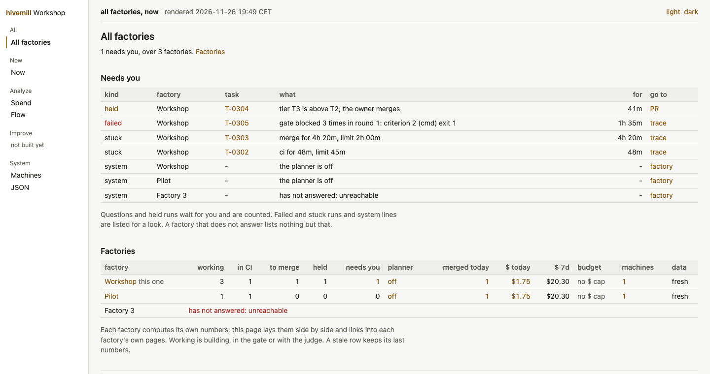
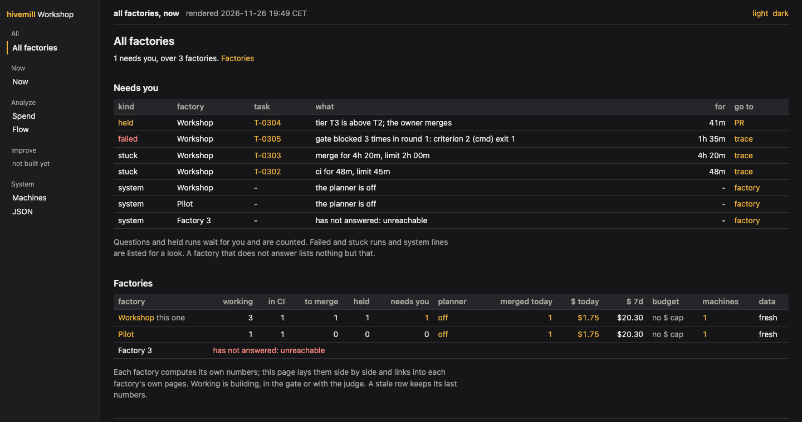

# hivemill observability: costs, traces, machines

The Option B runner ([option-b-runner.md](option-b-runner.md)) writes one line per step to `state/hivemill/events.jsonl`. Observability reads that log and nothing else, so the views are the same whether it runs on one laptop or on several machines. It has three parts:

- `hivemill obs`: a read-only local page.
- `hivemill obs pull`: copies other machines' logs.
- `hivemill otel export`: sends tasks as OpenTelemetry traces to any OTLP collector.

None of it changes a run, and nothing is on by default except the `machine` field.

Code: `go/internal/hm/obs.go` (the model), `obs_http.go` (the server), `obs_pages.go` and `assets/obs/` (the page shell, the Now, Spend, Flow and drill pages, and `app.css`), `obs_pull.go`, `otel.go`, `sessionend.go`. Tests: `go test ./internal/hm -run 'Obs|Otel|Portfolio|Pull|Emit|FailedRun'`.

## What the events carry

Every line has `ts`, `event`, `harness` and `machine`. Where they apply, it also has `task_id`, `goal_id`, `project`, `session_id`, `role`, `model`, `effort` and `cost_usd`.

- **`machine`** is the config key `machine_name`, or the short hostname when that is empty. Give every machine a unique name: two boxes with the same name merge their task keys. Make it the name hc and `session_machines` use for the box, or its pulled log shows as a second machine. When a line written before this field existed is read, it gets the name of the log it came from. For a pulled log whose stamped lines all name one machine, that name is used rather than the pull label, so a box never shows up under both its ssh alias and its own name.
- **`harness`** is `claude-code` today. An adapter for another harness (codex, pi) sets its own value, and `Emit` keeps it. The page and the traces only group by this field. Nothing in them depends on Claude Code.
- **`session.ended`** has the session's `cost_usd` at API prices. Its `data` has `input_tokens`, `output_tokens`, `cache_read_tokens` and `cache_write_tokens`, counted from the session's transcript (subagents included).
  - It is written when a run is merged, fails or is cancelled, and when an eval finishes.
  - The figures are cumulative. A later line for the same session replaces an earlier one; the lines are never added together.

## Zoom levels

| level | key | what it shows |
|---|---|---|
| portfolio | all | per project: $ today, 7 days and 30 days; tasks, active, merged; $ per merged PR; 2+ rounds %; median hours to merge; open owner questions |
| project | `project` | per goal: tasks, merged, active, failed, $, rounds, machines |
| goal | `goal_id` | per task: outcome, $ (task and judge), rounds, gate blocks, hours to merge, sessions |
| task | machine/`task_id` | outcome, $, rounds, findings, PR, trace id, its sessions, and the timeline of its events |
| session | `session_id` | role, model, effort, harness, machine, start and end, $, tokens, and its events |

- **Task key.** Task ids are numbered by each factory DB, so two machines can both have a `T-0042`. A task is therefore keyed by the machine that wrote its log and the task id. Projects and goals are grouped by name across machines.
- **Placed runs.** A run placed on another machine (`session_machines`) is logged by the coordinator. The views, the `machine` filter and the traces show such a task's events and sessions on the placement machine (the `data.machine` of its `task.dispatched`; `local` means the coordinator). A session whose `session.started` names its own machine, such as the judge, shows there. The machine filter keeps each task with a line on that machine as a whole, under the machine of its latest run; spend and planner sums count only that machine's sessions, while task, goal and outcome figures are whole-task totals. A trace's resource is the task's placement; each span's `hivemill.machine` is its session's. A machine's newest event is the latest line about its work, including lines the coordinator wrote. The key keeps the coordinator's name.
- **Which machines are listed.** Every machine in the logs, every placement, every `session_machines` entry and every pulled copy, including those with no run. Before `hc server status` first answers, the coordinator may show twice (its config entry and its own name).
- **Spend columns.** These sum the sessions *started* in the window. A session's whole cost counts on its start day, as in the digest.
- **Outcome columns.** These are `hivemill report`'s rules (`Summarise`), applied to the tasks with an event in the last `days` days (30 by default):
  - $ per merged PR is the $ of those tasks divided by the number merged.
  - 2+ rounds means judge verdicts plus red CI rounds is 2 or more, counted among merged tasks.
  - Hours are from dispatch to merge.
  - Eval runs are left out.
- **Pending cost.** A session with no `session.ended` line and no transcript on this machine is shown as cost *pending*. An example is a run that is still active on another machine.
- **Local sessions.** For sessions this machine ran, the page reads the transcripts and prices them, so a running session's $ is current.
- **Planner sessions** belong to no project. They are shown as `(no project)`.

## `hivemill obs`

The sidebar has three pages: Now (`/`), Spend (`/spend`) and Flow (`/flow`); the project, goal, task and session drill-down stays under Now. Flow also lists the runs past half of `run_max_working_min` in `working` (event `run.long_working`), with the time worked, the limit and the share passed; the table is hidden when there are none.

```
hivemill obs                     # http://127.0.0.1:7461/ (config obs_port), Ctrl-C stops
hivemill obs --port 7470
hivemill obs --listen 0.0.0.0   # reachable from other machines (config obs_listen); prints a WARNING
hivemill obs --json [--days N] [--machine M] [--harness H]   # the portfolio as JSON
hivemill obs sources             # the logs it reads
```

- **Runs by default.** The installer and `hivemill init` set obs up as a service next to the daemon, and `hivemill health` reports when it does not answer: see [supervision](option-b-runner.md#supervision).
- **Binding and requests.** The page binds to 127.0.0.1 by default and answers only GET and HEAD. A request whose `Host` is not a loopback name gets 403, which blocks DNS rebinding.
- **Other machines.** `--listen HOST`, or the config key `obs_listen`, picks the bind address: an IP address or `localhost`. A host name is a usage error (exit 2). An IPv4 address, `0.0.0.0` included, is served over IPv4 only. When the address is not loopback, one `WARNING` line goes to stderr: the page is read-only but readable by anyone on that network. It has no authentication, so use it only on a network you trust. A `Host` that is an IP address is then answered too; a DNS name still gets 403.
- **Self-contained.** It is plain HTML from `html/template` with one embedded stylesheet (`app.css`). There is no script, and nothing is loaded from another origin; the CSP header starts with `default-src 'none'` and allows stylesheets only from its own origin, so inline styles are blocked. The only outbound links are the PRs' own `https://github.com/...` URLs.
- **Filters.** `machine`, `harness` and `days` are query parameters, and every link keeps them. `GET /api/portfolio` returns the same filters' portfolio as JSON.
- **Open owner questions.** This machine's come from its `hm_asks` table. A pulled machine's are counted from its log: `ask.added` minus `ask.answered` and `ask.withdrawn` (same id).

## Several factories: the summary API and the hub

A factory is one runner with its own database and obs server. Two factories never share an event log: their task and goal ids are their own. What joins them is a small API and a page that lays the factories side by side.

**`GET /api/obs/v1/summary`** is everything one card of a factory needs. Every `v1` answer carries `"api": 1`; within a version a field is only ever added.

| Field | Meaning |
|---|---|
| `runner` | `id` (stable, says nothing about the machine), `label` (config `obs_label`), `version` (the build's commit), `projects`, `hub` (config `obs_hub_url`) |
| `counts` | open runs: `working` (building, in the gate, with the judge), `ci`, `merge`, `held` |
| `needs_you` | one list, in this order: `question` (an open owner question, with its text), `held` (with the hold's reason and PR), `failed` (in the last 24 h and not re-filed), `stuck` (longer in a stage than `obs_stuck_<stage>_min`), `system` (planner off or lost, a machine down, the weekly budget reached). `act` is true for questions and held runs. |
| `needs_you_count` | the `act` rows: the number a bar or a card shows |
| `planner` | `on`, `last_wake`, `pending`, `lost_since`, from the runner's own record |
| `merged`, `spend` | merged PRs today and per day (7 days); spend today, 7 days, per merged PR |
| `budget` | each cap that is set (`weekly_cap_usd`, `project_daily_cap_usd`, `task_cap_usd`) and the account's usage reading with its caps |
| `machines` | name, `label` (config `obs_machine_labels`), coordinator, down, running, free slots, memory, last seen |

The answer is built at most every 10 seconds, however many clients ask.

**The hub** is the All factories page: what needs you over every factory, then one row per factory, each linking into that factory's own pages. It keeps no data of its own.

```
hivemill config obs_peers http://HOST2:7461,http://HOST3:7461   # on one factory: its obs now serves /all, itself first
hivemill obs --hub --peers http://HOST1:7461,http://HOST2:7461  # on a machine with no factory: only the hub
```




- Every peer is asked at once, with a 3 second limit each, and at most every 15 seconds. `GET /api/obs/v1/factories` returns each factory's `summary` with `fetched_at`, `age_sec`, `stale` and `error`.
- A factory that stops answering keeps its row and its last numbers, marked stale or unreachable with their age. Its needs are no longer listed; one line says it does not answer.
- Peer addresses come only from this config or the command line, never from a request. The hub is read-only like the rest of obs, with the same headers and the same `Host` rule, so peers are named by IP address.
- The browser follows the links itself, so it must reach each factory's obs. Set `obs_listen` on each factory for that.
- A factory that is not the hub shows an "All factories" link when its `obs_hub_url` names the hub.

When obs listens beyond loopback, the pages and the API name no file path and no pull source.

## Several machines: `hivemill obs pull`

```
hivemill obs pull --from box-b:                       # ~/factory/state/hivemill/events.jsonl on box-b
hivemill obs pull --from op@box-b:/srv/hm/state/hivemill/events.jsonl --from box-c:
hivemill obs pull --from /mnt/share/box-d/events.jsonl --as box-d   # a mounted share
```

- **How it reads.** For a remote host it runs `ssh -o BatchMode=yes -- HOST 'cat -- PATH'`, which is read-only and never prompts. It writes the copy to `state/hivemill/obs/<label>/events.jsonl` and replaces the file each time, so pulling twice gives the same result as pulling once.
- **Labels.** The label defaults to the host without `user@`. A local file needs `--as NAME`. A label equal to this machine's own name is refused.
- **Duplicates.** The page and `otel export --pulled` read this machine's log plus every pulled copy. A line that appears in more than one source (the same bytes) counts once. Repeats inside one log are kept, as `hivemill report` counts them.
- **Keeping it fresh.** Pull from cron or a timer at whatever freshness you need, for example every 10 minutes. Nothing pulls on its own.
- **Several roll-up machines.** Several machines can each pull from the others. Each machine still writes only its own log.

## OpenTelemetry

```
hivemill otel export [--since 24h|2026-11-01] [--endpoint URL] [--pulled] [--dry-run]
hivemill config otel_endpoint https://otel.example:4318     # the daemon then exports finished tasks
```

### Protocol

The protocol is OTLP/HTTP with the JSON encoding, POSTed to `<endpoint>/v1/traces`. The suffix is added unless the URL already ends with it. The request is built by hand, so no SDK dependency is needed.

- **Endpoint.** The first of these that is set is used:
  1. `--endpoint`
  2. the config key `otel_endpoint`
  3. `OTEL_EXPORTER_OTLP_TRACES_ENDPOINT`
  4. `OTEL_EXPORTER_OTLP_ENDPOINT`
- **Credentials.** Headers come only from `OTEL_EXPORTER_OTLP_HEADERS` (`k=v,k2=v2`, URL-encoded values), for example `Authorization=Bearer%20...`. They live in the environment, never in the config table.
- **Batches.** At most 50 traces go in one request.

### The trace

| OTel | hivemill |
|---|---|
| trace | one task on one machine. The trace id is the first 16 bytes of sha256 of `machine/task` (the machine that wrote the log, also for a placed run), so exporting a task again gives the same ids |
| resource | `service.name=hivemill`, `host.name` and `hivemill.machine` = the machine |
| root span `task T-…` | from the first event to the terminal one. Attributes: `hivemill.task_id`, `goal_id`, `project`, `machine`, `harness`, `outcome`, `usd`, `rounds`, `gate_blocks`, `ci_rounds`, `pr`, `eval`, and the token totals. Status is OK when merged and ERROR on FAIL |
| child span `session <role>` | one per session (task, judge, planner). Attributes: `hivemill.session_id`, `role`, `model` (also `gen_ai.request.model`), `effort`, `harness`, `machine`, `usd`, `tokens`, `gen_ai.usage.input_tokens`, `gen_ai.usage.output_tokens`, `hivemill.tokens.cache_read`, `hivemill.tokens.cache_write`; `hivemill.cost_known=false` while the cost is pending |
| span events | an event with a `session_id` (gate blocked and passed, review findings, judge verdicts) is an event on that session's span. Every other event (dispatch, red CI, refresh, held, merge, failure, goal check) is an event on the root. `data` fields become `hivemill.<key>` attributes |

### The daemon tail

With `otel_endpoint` set, each daemon pass exports every task on this machine that reached a terminal event (merged, failed, cancelled, reverted, eval done) since its last export.

- It records what it sent in `state/hivemill/otel-exported.json`.
- A task that changes again later, such as a revert, is sent again with the same ids.
- The first pass after you set the key sends the whole history.
- Each request times out after 5 s. A failure is printed to the daemon log and retried on the next pass, and it never fails the pass.
- The tail exports only this machine's own log, so with several machines each one exports its own tasks. `otel export --pulled` is for one-off backfills from a roll-up machine.

### Backends

Any OTLP/HTTP receiver works: an OpenTelemetry Collector (`otlphttp` receiver on `:4318`), Grafana Tempo, Jaeger (OTLP enabled), Honeycomb, or a hosted vendor's OTLP endpoint. Costs then sit next to whatever else the org already traces. Sum `hivemill.usd` by `hivemill.project` and `hivemill.machine`, or by `gen_ai.request.model`.

## Config keys

| key | default | meaning |
|---|---|---|
| `machine_name` | empty | the `machine` of every event; empty means the short hostname |
| `obs_listen` | `127.0.0.1` | `hivemill obs` bind address (IP or `localhost`); `--listen` overrides it |
| `obs_port` | `7461` | `hivemill obs` port |
| `obs_label` | empty | this factory's display name in the API, the page title and the hub |
| `obs_machine_labels` | empty | display names of machines, `name=Label,name2=Label 2`; task keys and links keep the names |
| `obs_peers` | empty | other factories' obs URLs, comma-separated; turns on the All factories page at `/all` |
| `obs_hub_url` | empty | the hub's URL, for the "All factories" link on a factory that is not the hub |
| `obs_stuck_<stage>_min` | 120, 15, 45, 15, 120 | minutes a run may stay in `dispatched`, `gate`, `ci`, `judge`, `merge` before the summary lists it as stuck |
| `otel_endpoint` | empty | OTLP/HTTP base URL for the daemon tail; empty or `off` means no export |

## Limits

- **Pull is a snapshot.** Data from another machine is as fresh as its last pull.
- **Active remote runs.** A run that is still active on another machine has no cost until its run ends, because its transcript is not read remotely.
- **Large logs.** The page reads the logs on each request. That is fine for tens of thousands of lines, but a very large or hosted deployment would load them into a database instead, the Postgres store of [option-b-runner.md](option-b-runner.md#stage-2-hosted-design-notes-only).
