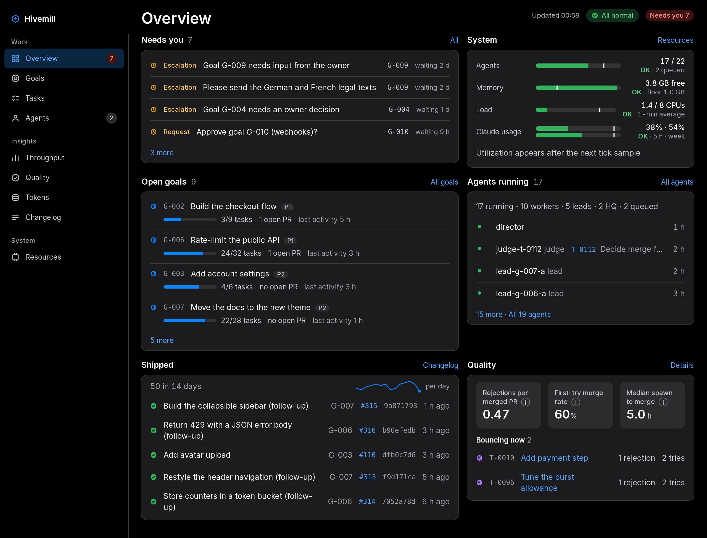
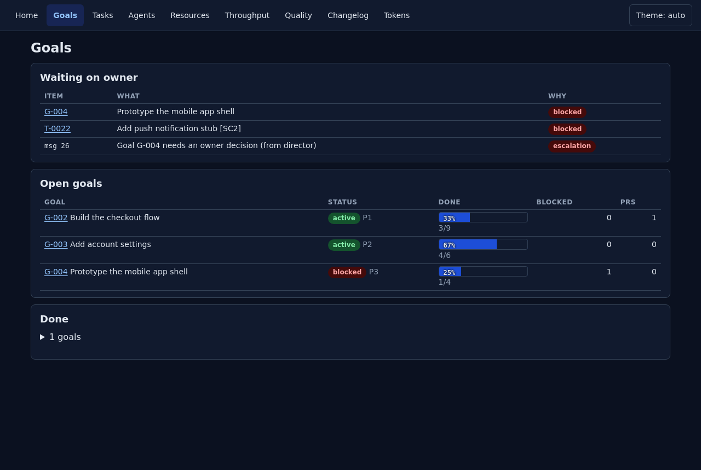
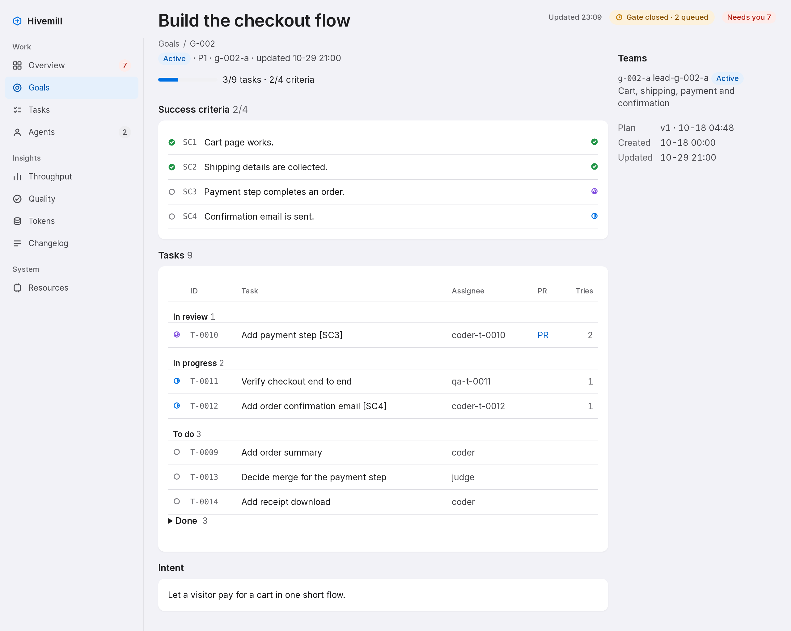
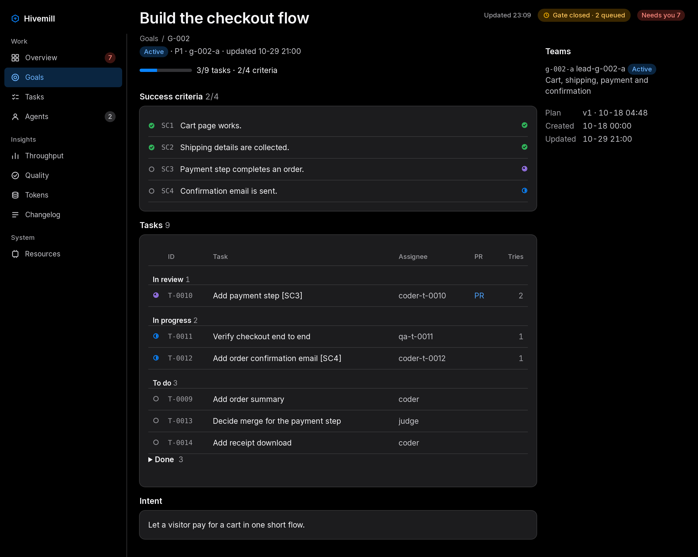
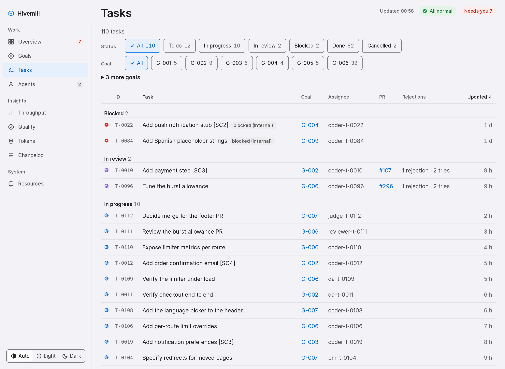
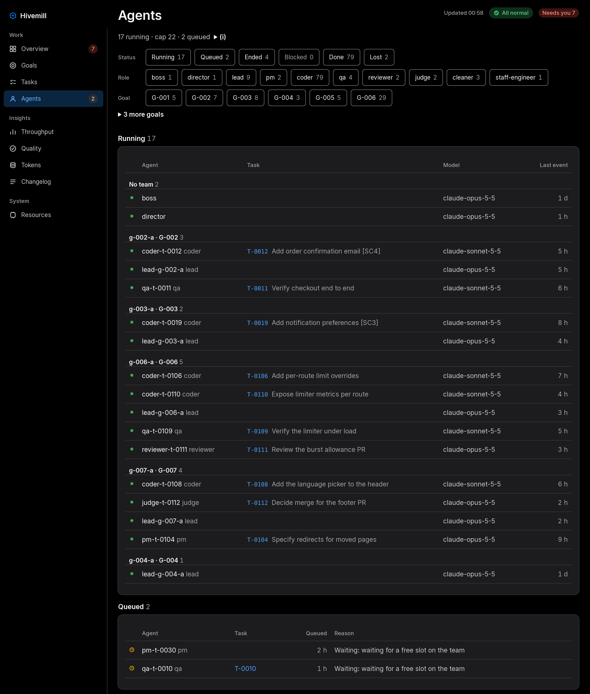
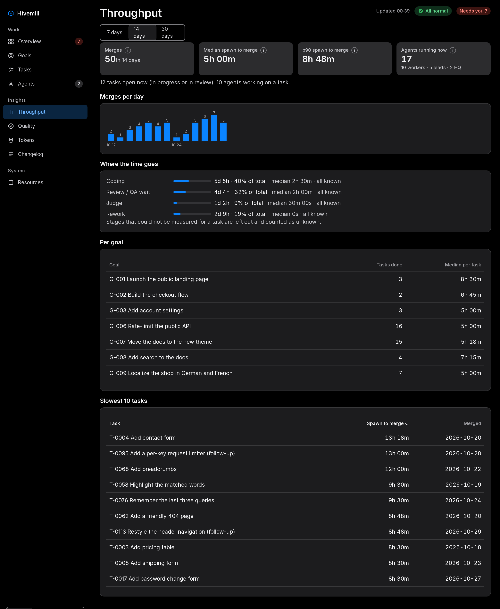
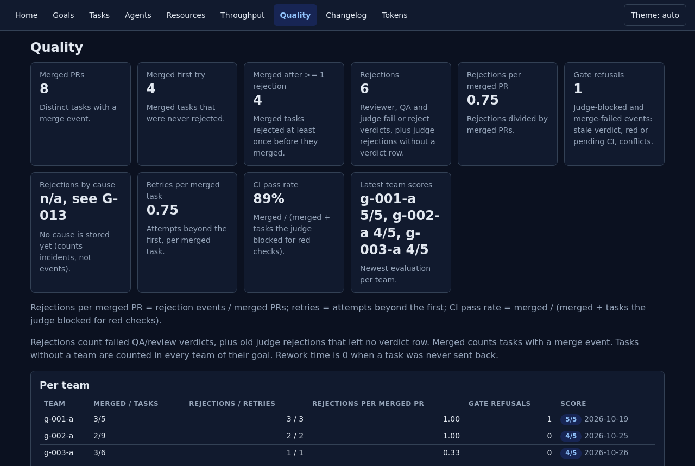

# Web UI screenshots

Light and dark screenshots of the factory web UI, taken from fictional demo data only (`ci/demo_seed.py`, see
`docs/demo-data.md`). They are regenerated by one script, never by hand.

## Regenerate

```
python3 ci/screenshots.py [--out docs/images] [--pages home,goals,...] [--now ISO]
```

Run it from a factory checkout. **Prerequisite: fonts.** The headless browser draws no text without them, so install
`fontconfig` and `fonts-dejavu-core` first (Debian/Ubuntu package names; the script never installs anything itself).
It exits 3 when it is not run from a checkout, when `--out` resolves outside `docs/images`, when no usable fonts are
found (checked before any download: `fc-list` on PATH and printing fonts, and `fc-match sans-serif` naming an existing
file), on a size or checksum mismatch, when a captured image shows no rendered text, or when a theme does not match its
file name. In order, it:

1. creates a temp dir and always removes it and terminates the server and browser (try/finally plus a SIGINT/SIGTERM
   handler: success, error, Ctrl-C), printing a `cleanup:` line;
2. downloads the pinned browser below, and checks its size and sha256 **before** unzipping (mismatch: abort);
3. unzips, then runs `ldd` on the binary and aborts, printing the `not found` lines, when system libraries are missing (it never
   installs anything: no package manager, no privilege escalation);
4. seeds a demo home with `ci/demo_seed.py --now <current hour, floored>` and serves it on `127.0.0.1` only, with
   its own `HOME` and `FACTORY_HOME` (the live home is never read or written);
5. scrub-scans each page's HTML with `ci/scrub_scan.py --path` and aborts on any hit. Set `SCRUB_TERMS_FILE` to the
   owner terms file (kept outside the repo) to include owner-specific terms; without it only the generic patterns run;
6. captures each page, light and dark, at 1280 CSS px wide and a device pixel ratio of 2 (`--force-device-scale-factor=2`,
   2560 px PNGs), in a window `HMAX` (1600) CSS px high, one browser process at a time with a fresh profile. The theme
   is forced through the browser's preferred colour scheme (Blink value 1 is light, 0 is dark), because
   `web/static/theme.js` follows the OS when no choice is stored; nothing under `web/` changes;
7. crops each capture to its content: trailing rows equal to the page background (within 8 per channel) are dropped,
   keeping a 32 CSS px (64 px) bottom margin and a minimum height of 400 CSS px. The background is the most frequent
   colour of the capture's last row, and the crop is measured on the main column only (right of the 232 px sidebar and
   its hairline, `SIDEBAR_CSS_PX`, checked against `web/static/app.css` by a test); the PNG keeps the full width.
   Long lists show the top `HMAX` CSS px: a page whose content reaches the window, or ends in a short background tail
   (`WINDOW_TAIL`), is cut in the last gap between sections (`SECTION_GAP_MIN` background rows, half the gap kept), not
   through a card or a heading, and the script prints `INFO <file>: truncated at HMAX (1600 CSS px)`. `/tasks` is a flat
   table with no section gaps: it is cut by its fixed `PAGE_HEIGHT`, chosen just above the "To do" group heading.
   Every browser run sets `--virtual-time-budget` so the web fonts (Inter) are loaded before the screenshot, and the
   demo server runs with a pinned load and free memory (`DEMO_MACHINE`), so the System card reads the same on any host;
8. decodes each PNG (stdlib only) and checks the top 400 px: at least 200 distinct colours (anti-aliased text; a page
   without text has a few dozen), and each page's light image has a mean luminance at least 40 above its dark image;
   then rejects mostly empty images: a row is blank when 99% of its main-column pixels are background, and only runs
   of at least 48 blank rows (24 CSS px) count, so line spacing does not. More than 35% blank rows exits 3 with
   `<file>: <pct>% blank rows (limit 35%)`;
9. builds `hero.png` (the light home page | a 2 px neutral divider | the dark home page, each downscaled by 2 so the
   divider sits in the gutter and never crosses text; the smaller of the two heights) and `social-preview.png`
   (exactly 1280x640, at most 1 MB, GitHub's limit): a 160 px top band with the wordmark (`wordmark-light.svg`,
   cropped to its ink) and a one-line tagline in Inter (the SemiBold woff2 is inlined) over the hero downscaled by 2.
   The browser screenshots a small local HTML page for it (the wordmark inline, the hero as a `data:` image, no
   external URL) at 1280x640, DPR 1;
10. checks the sizes: it prints `WARN` above 307200 bytes per PNG, and exits 3 above 716800 bytes for one PNG or
    8388608 bytes for all together (director M6655), listing every file's size. Nothing is written to `docs/images/`
    on any failure above (everything is built in the temp dir first);
11. copies the images into `docs/images/` and prints a summary and the exact list of files written (`files: ...`).

## Pinned browser

Chrome for Testing headless shell, the only thing the script downloads:

| | |
|---|---|
| Version | 131.0.6778.204 (linux64) |
| URL | https://storage.googleapis.com/chrome-for-testing-public/131.0.6778.204/linux64/chrome-headless-shell-linux64.zip |
| Size | 113084320 bytes |
| sha256 | `afaac86e302c4874245991a3d509d529c50ecdd447affff0cdc2b08520906c32` |

## Images

Committed from one `python3 ci/screenshots.py` run (T-0480; T-0727 regenerated home, tasks, agents, hero and the social preview; Inter at 2x). Page images are 2560 px wide (1280 CSS px at 2x). `/tasks` is captured at 936 CSS px (`PAGE_HEIGHT`) to stay under the
per-PNG cap; the other pages use `HMAX` (1600).

| File | Page | Theme | Pixels (w x h) | Bytes |
|---|---|---|---|---|
| home-light.png | Home | light | 2560 x 1949 | 418931 |
| home-dark.png | Home | dark | 2560 x 1950 | 418824 |
| goals-light.png | Goals | light | 2560 x 2672 | 366556 |
| goals-dark.png | Goals | dark | 2560 x 2672 | 367537 |
| goal-light.png | Goal | light | 2560 x 2043 | 241866 |
| goal-dark.png | Goal | dark | 2560 x 2044 | 243659 |
| tasks-light.png | Tasks | light | 2560 x 1872 | 318193 |
| tasks-dark.png | Tasks | dark | 2560 x 1872 | 319185 |
| agents-light.png | Agents | light | 2560 x 3009 | 378334 |
| agents-dark.png | Agents | dark | 2560 x 3009 | 377916 |
| throughput-light.png | Throughput | light | 2560 x 3110 | 356615 |
| throughput-dark.png | Throughput | dark | 2560 x 3111 | 358938 |
| quality-light.png | Quality | light | 2560 x 2549 | 220236 |
| quality-dark.png | Quality | dark | 2560 x 2549 | 222533 |
| hero.png | Home (light left, dark right) | both | 2562 x 974 | 386030 |
| social-preview.png | Social preview (wordmark + tagline over hero) | light | 1280 x 640 | 173207 |
| **Total** | | | | 5168560 |

| Page | Light | Dark | What it shows |
|---|---|---|---|
| Home |  |  | Overview cards: live agents, open PRs, goals by status, waiting on owner, usage. |
| Goals |  |  | Waiting-on-owner items, open goals with progress bars, done goals. |
| Goal |  |  | Goal detail (`/goal/G-002`): intent, plan, teams, tasks and progress. |
| Tasks |  |  | Task list with goal, status, PR and CI state, rejections and tries. |
| Agents |  |  | Status, role and goal filters, teams, live agents with model and uptime. |
| Throughput |  |  | Merges per day, median and p90 spawn-to-merge, open tasks, live workers. |
| Quality |  |  | Merge, rejection, retry and CI pass-rate cards; per-team scores. |

## Wordmark

`wordmark-light.svg` (dark text, for light backgrounds) and `wordmark-dark.svg` (light text, for dark backgrounds) are
the Hivemill wordmark: a three-cell honeycomb mark (one filled cell) and the name, 360x80. They are hand-written,
self-contained SVG (no external fonts, images or links) with identical geometry; only the colours differ. The name is
converted to paths from DejaVu Sans Bold (Bitstream Vera / DejaVu licence, which allows embedding and modification), so
it renders the same offline without any installed font.
Embed them with a `<picture>` that switches on `prefers-color-scheme`. Hivemill's CLI is `factory`.
