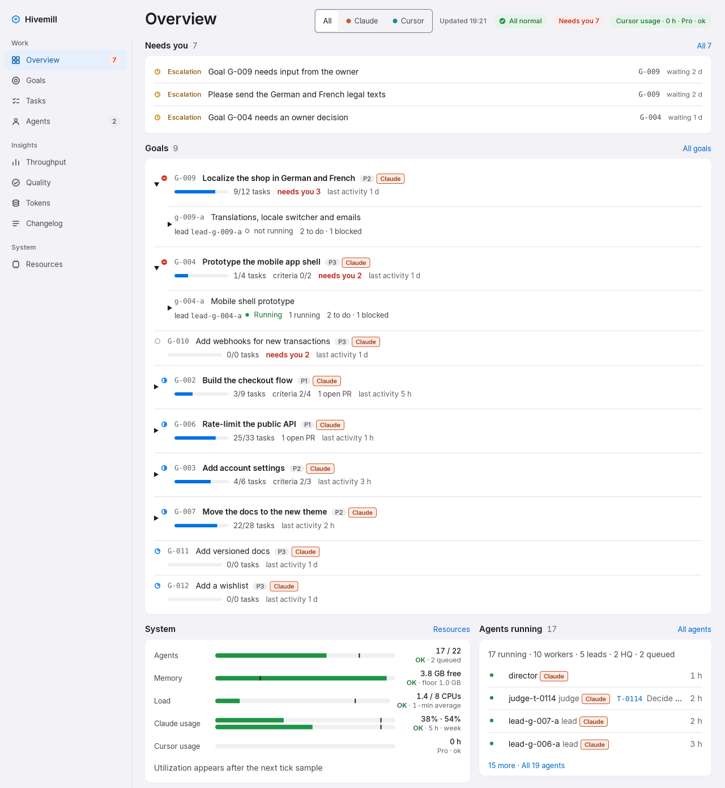
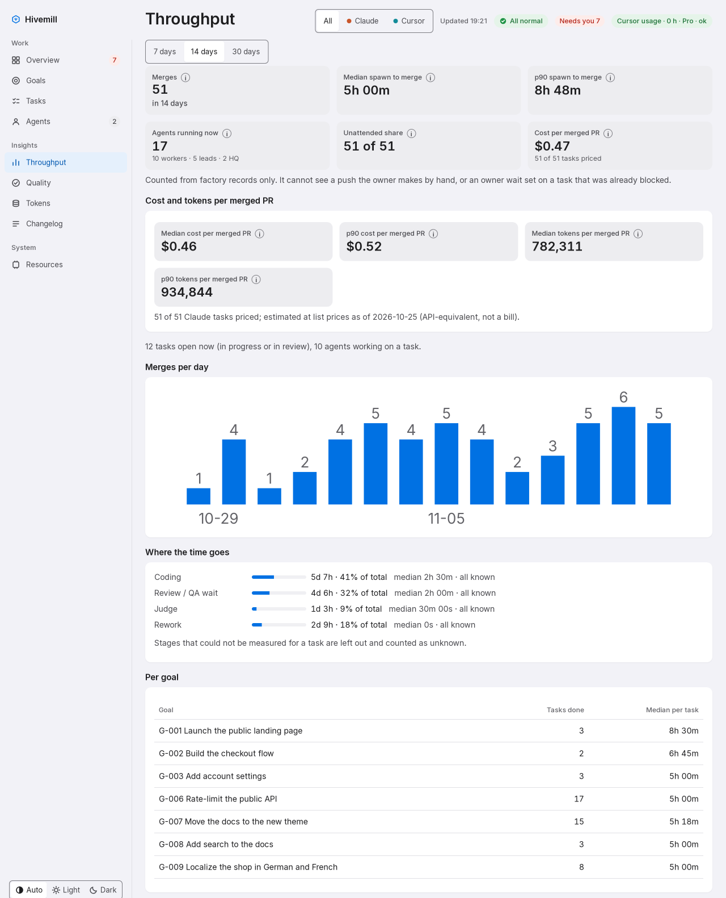

# What's new in Hivemill v0.4.0

Hivemill v0.4.0 is a pre-release that makes the factory easier to install, easier to follow from your phone and clearer about what each change costs. This page sums up what changed for you; the [CHANGELOG](../../CHANGELOG.md) has every detail.

## What changed

- **A daily report on why work was rejected.** Once a day, one advisory agent reads the day's rejections and gate refusals. It reports the top causes, the evidence and one or two proposed fixes, and the report arrives in the daily digest. The agent cannot merge, push, edit role files or change a gate. It is on by default; set `retro_enabled` to `0` to turn it off.
- **Install in three commands.** A Claude Code plugin and a non-interactive installer replace the long manual setup. The install section of the README is now three commands.
- **A web UI made for your phone.** Pages are laid out phone-first. The Overview shows a tree of goals and teams and a "needs you" strip. There is also a new changelog page.
- **Cost, time and tokens for each merged PR.** A task page shows each stage, the tokens and estimated cost per agent, and what rework cost. A goal page has a "Cost and time" card. The throughput page shows the median and p90 cost and tokens per merged PR, and the task list can sort by cost, tokens and wall time. All costs are estimates at list prices, not a bill.
- **A token limit per goal.** Set one with `factory goal edit` and `--token-limit N`. The factory warns once at 80% and starts no new coder or pm on a goal that has reached its limit. The tally is off until you set `goal_token_tally_s`, and the limit applies only to goals in the Claude org.
- **The Go worker guard is closer to the Python one.** It now mirrors many more of the Python guard's rules, and a check compares the two. The Go guard is opt-in through `guard_impl`; the Python guard stays the default.
- **A stricter worker guard.** Agents with restricted roles lose many more ways around the guard, such as pushing through indirect git commands or writing through `gh`. The factory's own git helper can no longer move the live checkout off main.

## Known limits

This is a pre-release, so interfaces may change before 1.0; the `hc` terminal backend is experimental, the daily report needs the Cursor runtime, and the factory runs on a single machine.

## Upgrade

A live factory needs no checkout: within a minute, the tick fast-forwards main in `~/factory` to the tag commit. Use `git checkout v0.4.0` only for a fresh install that is not live yet. Then run any `factory` command once so the database migration runs, and run `factory flags` to review the new settings. One change can break scripts: `factory verdict --fail` and `factory judge --reject` now require `--cause`. The full steps are in the Upgrade section of the [CHANGELOG](../../CHANGELOG.md).
